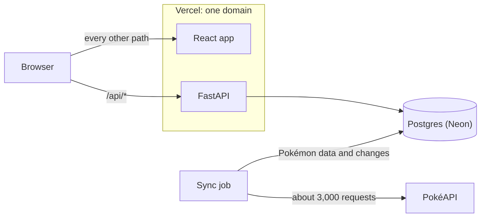

# Counterdex

Counterdex lets you build Pokémon teams, see how to beat any team, and find out when PokéAPI
changes a Pokémon on one of your teams.

[Live app](https://counterdex.vercel.app) · [API docs](https://counterdex.vercel.app/api/docs) ·
[Backend guide](backend/README.md) · [Frontend guide](frontend/README.md)

The frontend is a React app built with Vite, TanStack Query, Tailwind and shadcn/ui. The backend is
a FastAPI app that uses SQLAlchemy and Alembic with a Postgres 17 database on Neon. Both run on
Vercel. The backend is tested with pytest against a real Postgres, and the frontend with Vitest.

## What I built

| Part of the brief | What the app does |
| --- | --- |
| 1.1 Show every Pokémon | The Pokédex shows all of about 1,350 Pokémon, including Mega and regional forms, as cards with their types, base stats and sprites. You can search it, filter it by type, and use it on a phone. |
| 1.2 Build a team of up to six | You add Pokémon from the Pokédex, drag them to reorder, and remove or replace them. Every edit is saved to your account straight away. |
| 1.3 Manage many teams | You can create, rename and delete as many teams as you like, and browse and search everyone else's teams too. |
| 1.4 Counter teams | For any team, the app builds a counter team of the same size, in battle order. Every pick comes with a reason and a grid of matchups, and one click saves it as your own team. On your own teams, the app shows their biggest threats instead. |
| 2 Change alerts | A sync job copies PokéAPI into the database and records every change it finds. A team with a changed Pokémon says so, each changed slot shows exactly what changed, and a banner sums up the latest sync. |

Anyone can browse without an account. To build teams, you sign up with a username and password.

## How it works



The app doesn't call PokéAPI while you use it. Instead, a sync job fetches every Pokémon, species
and type from PokéAPI, which takes about 3,000 requests and about 10 seconds. It saves them all to
the database in one go.

While it syncs, the job compares each Pokémon with the copy it already has. When something has
changed, it keeps a record of what the Pokémon looked like before and after.

The API serves everything from that copy, including the Pokédex, accounts, teams and counter teams.
The React app only ever talks to the API. The one exception is sprite images, which still load
from PokéAPI's image server.

The app and the API are deployed together on one domain. Vercel sends requests for `/api/...` to
FastAPI and everything else to the React app. Because they share a domain, there's no cross-origin
setup to get right, and sign-in cookies work without extra configuration.

## Change alerts

Here's how a change in PokéAPI reaches your team.

1. The sync works out a fingerprint (a hash) of what you can see about each Pokémon, which is its
   name, types, base stats, sprite and form. If the fingerprint is different from last time, the
   Pokémon has changed. A Pokémon that leaves PokéAPI's list, or comes back to it, also counts as
   a change.
2. Each change is saved with a snapshot of the Pokémon before and after. The Pokémon also records
   when it last changed.
3. Whenever the API sends back a team, it marks each member whose Pokémon changed in the last seven
   days.
4. The team page then says which members changed this week, and each changed slot shows the
   details, such as "Attack 84 → 104". If a Pokémon was removed from PokéAPI, it stays on the team
   but greyed out, and the owner gets a link to replace it.

Nothing is stored for each user, so an alert can never go out of date. It simply disappears after
a week.

### Trying it out

PokéAPI rarely changes, so I wrote a demo job called `demo_changes` that makes it look as if it
had. It runs the real sync against PokéAPI's real responses, but edits them on the way in so that

- Charizard gains 20 Attack and 20 Speed,
- Gengar becomes Ghost and Fairy type,
- Pikachu disappears from PokéAPI's list, and
- Garchomp, Snorlax, Lucario and Dragonite get smaller stat changes.

Everything after the network request is the same code that runs in production. So the demo shows
the real change detection working, rather than rows I wrote into the database by hand.

The live site has already had this demo run, so any team there with one of these Pokémon shows
the alerts this week. To try it on your own machine, run these from the `backend` folder.

```bash
uv run --env-file ../.env python -m app.jobs.seed_teams YOUR_USERNAME   # 28 sample teams, 7 yours
uv run --env-file ../.env python -m app.jobs.demo_changes               # pretend PokéAPI changed
```

`seed_teams` needs an account that you've already signed up for. Afterwards, running the normal
sync puts PokéAPI's real data back. It records that as changes too, including Pikachu coming back.

## Counter teams

PokéAPI doesn't include moves, so Counterdex can't simulate real battles. Instead, it scores every
pair of Pokémon. It uses those scores to build counter teams and to find threats to your teams.

### How the scoring works, and why

Here's an example. Pikachu is up against Gyarados.

| Step | What happens | Points |
| --- | --- | --- |
| Pikachu attacks | Electric hits Water types twice as hard, and Flying types twice as hard. Gyarados is both, so Pikachu hits it four times as hard. | +2 |
| Gyarados attacks | Its best attack is Water, which hits Pikachu normally. | 0 |
| Base stats | Pikachu's stats add up to 320. Gyarados's add up to 540. Pikachu is 220 behind. | −0.55 |
| Speed | Pikachu (90) is faster than Gyarados (81). | +0.25 |
| **Total** | | **+1.70** |

Anything 0.75 or higher is Good, so Pikachu beats Gyarados. Its type advantage matters more than its
weaker stats. For Gyarados, the score flips to −1.70, which is Bad.

The rules are simple.

- **Attacks count the most.** Every time an attack's damage doubles, it's worth 1 point. So 2× is
  +1 and 4× is +2. Weak attacks lose points the same way. ½× is −1, ¼× is −2, and no effect is −3.
  The other Pokémon's best attack is scored the same way and taken away.
- **Base stats count a little.** Every 100 points of difference is worth 0.25. A stat gap only beats
  a type advantage when it's 400 points or more, and that's rare.
- **Speed counts a little too.** Being faster is worth +0.25, and being slower is −0.25.
- **The total sets the rating.** 0.75 or more is Good, −0.75 or less is Bad, and anything in between
  is Even.

I picked these numbers by hand, since there's no battle data to learn them from. Then I checked them
against the real Pokédex. Types decide most matchups, and stats mostly settle the close ones.

### Building a counter team

Counterdex builds a counter team one Pokémon at a time. Each time, it adds the Pokémon that helps
most against the other team. It tries not to pick three or more Pokémon with the same weakness. It
never picks two Pokémon from the same evolution family. Legendary Pokémon and alternate forms are
left out unless you turn them on. The team comes back in battle order, and every pick says why it
was chosen.

Why one at a time? Checking every possible team of six would mean looking at about 1.6 quadrillion
teams. Picking one at a time is instant and always gives the same answer. It can sometimes miss a
team that only works well as a whole.

### Threats to your own team

On your own teams, Counterdex shows the 12 Pokémon that do best against your team. It picks at most
one from each evolution family, and skips your own team's families. If at least half of those
threats beat one of your Pokémon, that Pokémon is marked as a weak spot.

All the numbers live in [`backend/app/counter/constants.py`](backend/app/counter/constants.py), with
a note explaining each one. The [backend guide](backend/README.md#counter-teams) has more detail.

## Design decisions

- **I keep a copy of PokéAPI instead of calling it live.** PokéAPI's list only gives names, so a
  grid with types and stats would need a separate request for every Pokémon. Having a copy also
  makes search, filters and change tracking possible. The downside is that the data is only as
  fresh as the last sync, so the app shows when that was.
- **Only changes you can see count.** Each Pokémon gets one fingerprint of what you can see about
  it, which makes comparing fast and exact. The downside is that changes to species, evolution
  families and the type chart don't trigger alerts.
- **Alerts are worked out when a team loads.** Each Pokémon remembers when it last changed, and
  loading a team checks that date. There's no notification queue and nothing stored for each user.
  The downside is that you can't dismiss an alert early, and there are no emails or push
  notifications.
- **Every team edit saves right away, one at a time.** There's no Save button to forget. The
  browser sends edits in order, and the API locks the team while it applies each one. That way,
  double clicks and two open tabs can't mess up a team. The downside is more requests.
- **The database enforces the team rules.** A team can have at most six members, one Pokémon in
  each slot, and one Pokémon from each evolution family. These are database rules, so they hold
  even when two requests arrive at the same time. The API checks them first so it can explain why
  it said no. The downside is that the rules live in two places.
- **I built my own simple sign-in.** Passwords are hashed with argon2id, and the database only
  stores a hash of each session token. The sign-in cookie can't be read by JavaScript or sent from
  other sites. The downside is that there's no email, so there's no password reset.
- **The frontend's API code is generated from the backend.** If the backend renames a field, the
  frontend fails to compile instead of breaking for users. A test fails if the generated code falls
  behind. The downside is one extra command after each API change.

## Assumptions

- **Moves aren't synced.** The app only needs each Pokémon's name, types, base stats and picture.
- **Alternate forms count as their own Pokémon.** For example, Mega Charizard X has its own stats
  and its own card.
- **A team can have one Pokémon per evolution family.** So Charmander and Charizard can't be on the
  same team. This is stricter than the games, which only stop you using the same Pokémon twice.
- **A missing Pokémon counts as removed.** If a Pokémon disappears from PokéAPI's list, the app marks
  it as removed. But if a lot disappear at once (more than 5%, or more than 10 if that's higher),
  the sync assumes PokéAPI sent a broken response and stops.
- **New Pokémon aren't changes.** A Pokémon that's new to PokéAPI can't be on anyone's team yet, so
  there's nothing to alert anyone about.
- **"This week" starts when the app noticed.** PokéAPI doesn't say when it changed something, so the
  week counts from when the sync spotted the change.
- **Teams are public.** Anyone can look at any team and see how to beat it. Only the owner can
  change it.

## Running it locally

You'll need Docker, [uv](https://docs.astral.sh/uv/) and Node. Node has to be version 22.22.2 or
later in 22, 24.15.0 or later in 24, or 26 and up. Run these from the repository's root folder.

```bash
cp .env.example .env && docker compose up -d --wait     # starts Postgres on localhost:5432
cd backend && uv sync
uv run --env-file ../.env alembic upgrade head          # creates the tables
uv run --env-file ../.env python -m app.jobs.sync_pokemon   # loads PokéAPI (about 10 seconds)
cd ../frontend && npm ci && cd ..
vercel dev                                              # app and API on localhost:3000
```

`vercel dev` needs you to run `vercel link` once first. If you'd rather not use Vercel, you can
start the API with uvicorn on port 3000 and the app with `npm run dev`. The
[backend](backend/README.md#running-it) and [frontend](frontend/README.md#running-it) guides explain
both ways, and how to run the tests (`uv run pytest`, which needs Docker, and `npm test`).

## Project layout

```
backend/             the FastAPI app, the sync and demo jobs, migrations and tests
frontend/            the React app and its tests
docker-compose.yml   Postgres for local development
vercel.json          sends /api to FastAPI and everything else to the React app
```

## What I'd do next

- I'd schedule the sync. It runs by hand today, and a daily Vercel Cron job would be enough, since
  PokéAPI caches its responses for 24 hours.
- I'd add CI and run migrations automatically. Today the tests and checks run on my machine, and
  migrations run by hand before a deploy.
- I'd make counters aware of moves and abilities. That would turn the counter team from an estimate
  based on types and stats into a real battle prediction.
