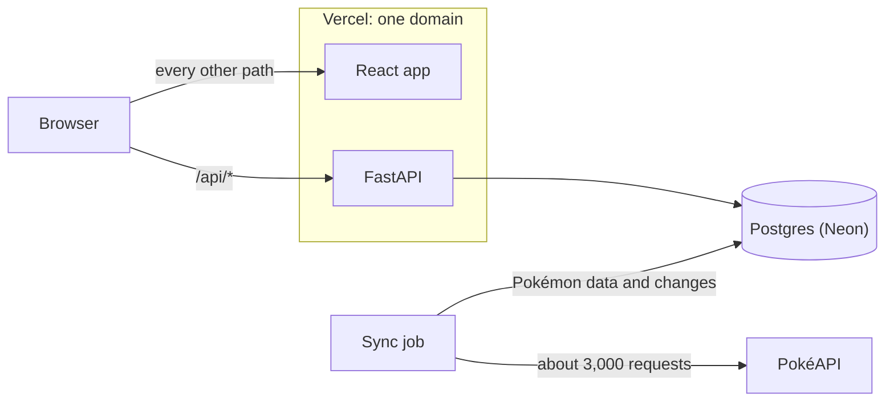

# Counterdex

**Build Pokémon teams, see how to beat any team, and get told when PokéAPI changes a Pokémon on
one of yours.**

[Live app](https://counterdex.vercel.app) · [API docs](https://counterdex.vercel.app/api/docs) ·
[Backend guide](backend/README.md) · [Frontend guide](frontend/README.md)

**Stack:** React 19, Vite, TanStack Query, Tailwind and shadcn/ui · FastAPI, SQLAlchemy and
Alembic · Postgres 17 on Neon · Vercel · pytest with Testcontainers, Vitest with MSW

## At a glance

| The brief | What I built |
| --- | --- |
| **1.1** Show every Pokémon | A Pokédex of all ~1,350 Pokémon, including Mega and regional forms, as cards with types, base stats and sprites. Search, filter by type, and use it on a phone. |
| **1.2** Build a team of up to 6 | Add from the Pokédex, drag to reorder, remove or replace. Every edit saves instantly to your account. |
| **1.3** Manage many teams | Create, rename and delete as many teams as you like. Browse and search everyone else's too. |
| **1.4** Counter team | For any team, a counter team of the same size, in battle order, with a reason for every pick and a matchup grid. One click saves it as your own team. Your own teams show their biggest threats instead. |
| **2** Change alerts | A sync job copies PokéAPI into Postgres and records every change it finds. Teams with a changed Pokémon say so, each changed slot shows exactly what changed, and a banner sums up the latest sync. |

You can browse everything without an account. Sign up with a username and password to build
teams.

## How it works



- **PokéAPI is copied, not called live.** A sync job fetches every Pokémon, species and type (about
  3,000 requests, about 10 seconds) and writes them to Postgres in a single transaction.
- **Changes are recorded as they're found.** The sync compares each Pokémon with the stored copy
  and keeps a before-and-after record of anything that changed.
- **The API serves that copy.** FastAPI handles the Pokédex, accounts, teams and counter teams.
  The React app only ever talks to the API (sprite images still load from PokéAPI's image host).
- **One deployment, one domain.** Vercel sends `/api/*` to FastAPI and everything else to the
  React app, so there's no CORS to configure and cookies just work.

## Change alerts (Task 2)

1. **Detect.** The sync hashes each Pokémon's visible data: name, types, base stats, sprite and
   form. A different hash, or a Pokémon leaving or rejoining PokéAPI's list, counts as a change.
2. **Record.** Each change is saved with before-and-after snapshots, and the Pokémon is stamped
   with `last_changed_at`.
3. **Flag.** Whenever the API returns a team, it marks each member whose Pokémon changed in the
   last 7 days.
4. **Show.** The team page says which members changed this week, and each changed slot shows the
   details, such as *Attack 84 → 104*. A removed Pokémon stays on the team, greyed out, with a
   Replace link for the owner.

Nothing is stored per user, so an alert can't go stale, and it disappears by itself after a week.

### Demo

PokéAPI rarely changes, so I wrote a demo runner, `demo_changes`. It runs the real sync against
PokéAPI's real responses, edited on the way in:

- Charizard gains 20 Attack and 20 Speed
- Gengar becomes Ghost/Fairy
- Pikachu disappears from PokéAPI's list
- Garchomp, Snorlax, Lucario and Dragonite get smaller stat changes

Everything after the network layer is production code, so it shows real detection working, not
hand-written database rows. **The live site has already had this run**, so any team with one of
these Pokémon shows the alerts this week. To try it locally:

```bash
cd backend
uv run --env-file ../.env python -m app.jobs.seed_teams YOUR_USERNAME   # 28 sample teams, 7 yours
uv run --env-file ../.env python -m app.jobs.demo_changes               # simulate PokéAPI changes
```

`seed_teams` needs an account you've already signed up for. Running the normal sync afterwards
restores PokéAPI's real data and records that too, including Pikachu coming back.

## Counter teams (Task 1.4)

The data has no moves, so instead of simulating battles, Counterdex scores matchups.

- **One matchup** scores a Pokémon against an opponent on four things: its best attacking type
  against them, their best attacking type against it, base stat total and Speed. Type advantage
  usually decides it, but a big enough stat gap can win.
- **The counter team** is built one pick at a time. Each pick is the Pokémon that most improves
  the team's best answer to every opponent, with a penalty if too many picks share a weakness.
- **The picks are a valid team**, one per evolution family. Legendaries and alternate forms are
  left out unless you ask, and the team comes back in battle order.
- **Every pick is explained.** Each matchup comes with its score breakdown, which the app turns
  into a plain-English reason.

The details and weights are in the [backend guide](backend/README.md#counter-teams).

## Key design decisions

**Store a copy of PokéAPI instead of calling it live.** PokéAPI's list endpoint returns only names.
A grid with types and stats would need a request per Pokémon, with no search or filtering, and
detecting changes needs a stored copy anyway.
*Trade-off:* the data is only as fresh as the last sync, so the app always shows when that was.

**Count only changes users can see.** One hash per Pokémon makes comparing exact and cheap, and
the snapshots let the app say precisely what changed.
*Trade-off:* species, evolution families and the type chart are refreshed silently.

**Work out alerts when a team is read, not with a notification queue.** Each Pokémon remembers
when it last changed, and every team read checks that date. There are no per-user copies to fan
out or clean up.
*Trade-off:* a team's alert can't be dismissed early, and there's no email or push.

**Save every edit immediately, one at a time per team.** There's no Save button to forget. The
browser sends a team's edits in order, and the API locks the team while applying each one, so
double clicks, retries and two open tabs can't scramble a team.
*Trade-off:* more requests, and ordering logic on both sides.

**Let the database enforce the team rules.** Six members at most, one Pokémon per slot and one
per evolution family are database constraints. They hold even during races, or when a sync moves
a species to another family. The API checks first so it can explain a refusal.
*Trade-off:* the rules live in two places, the API and the schema.

**Run my own accounts on one domain.** Passwords are hashed with argon2id, and the database stores
only a hash of each session token. The session cookie is `HttpOnly` and `SameSite=Strict`, and
cross-site writes are refused.
*Trade-off:* there's no email, so there's no password reset.

**Generate the frontend's API client from the backend.** FastAPI's OpenAPI schema generates the
TypeScript types, fetch functions and query hooks, so a renamed field becomes a type error. A test
fails if the committed schema falls behind.
*Trade-off:* a regeneration step after every API change.

## Assumptions

- The grid needs name, types, base stats and sprite, so moves aren't synced.
- Alternate forms, such as Mega Charizard X, are separate Pokémon with their own stats.
- A team holds at most one Pokémon per evolution family, so Charmander and Charizard can't share
  one. This is stricter than the games' rule of one per species.
- A Pokémon missing from PokéAPI's list has been removed, unless more than 5% (or 10, if that's
  more) vanish at once. That looks like a broken response, so the sync stops instead.
- A Pokémon new to PokéAPI isn't a change, because no team can have it yet.
- "Changed in the last week" counts from when the sync noticed. PokéAPI doesn't say when it
  changed something.
- Teams are public to view, so anyone can see how to beat them. Only the owner can edit one.

## Run it locally

You need Docker, [uv](https://docs.astral.sh/uv/) and Node `^22.22.2 || ^24.15.0 || >=26`.

```bash
cp .env.example .env && docker compose up -d --wait     # Postgres on localhost:5432
cd backend && uv sync
uv run --env-file ../.env alembic upgrade head          # create the tables
uv run --env-file ../.env python -m app.jobs.sync_pokemon   # load PokéAPI (about 10 seconds)
cd ../frontend && npm ci && cd ..
vercel dev                                              # app and API on localhost:3000
```

`vercel dev` needs a one-time `vercel link`. To run without Vercel, start the API with uvicorn on
port 3000 and the app with `npm run dev`. The [backend](backend/README.md#running-it) and
[frontend](frontend/README.md#running-it) guides cover both, plus tests (`uv run pytest`, which
needs Docker, and `npm test`).

## Project layout

```
backend/             FastAPI app, sync and demo jobs, migrations and tests
frontend/            React app and its tests
docker-compose.yml   Postgres for local development
vercel.json          sends /api to FastAPI and everything else to the React app
```

## What I'd do next

- **Schedule the sync.** It runs by hand today. A daily Vercel Cron job would be enough, since
  PokéAPI caches its responses for 24 hours.
- **Add CI and automatic migrations.** Tests and checks run locally, and migrations run by hand
  before a deploy.
- **Make counters battle-aware.** Moves and abilities would turn the counter team from a type and
  stats estimate into a battle prediction.
