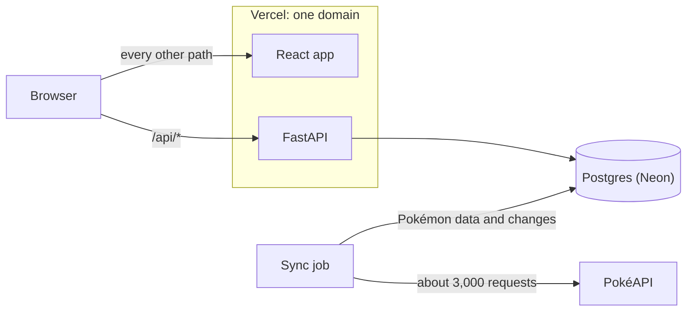

# Counterdex

Counterdex lets you build Pokémon teams, see how to beat any team, and find out when PokéAPI
changes a Pokémon on one of your teams.

[Live app](https://counterdex.vercel.app) · [API docs](https://counterdex.vercel.app/api/docs) ·
[Backend guide](backend/README.md) · [Frontend guide](frontend/README.md)

The frontend is a React app built with Vite, TanStack Query, Tailwind and shadcn/ui. The backend is
a FastAPI app that uses SQLAlchemy and Alembic with a Postgres 17 database on Neon. Both run on
Vercel. The backend is tested with pytest against a real Postgres, and the frontend with Vitest.

## What I built

| Part of the brief | What the app does |
| --- | --- |
| 1.1 Show every Pokémon | The Pokédex shows all of about 1,350 Pokémon, including Mega and regional forms, as cards with their types, base stats and sprites. You can search it, filter it by type, and use it on a phone. |
| 1.2 Build a team of up to six | You add Pokémon from the Pokédex, drag them to reorder, and remove or replace them. Every edit is saved to your account straight away. |
| 1.3 Manage many teams | You can create, rename and delete as many teams as you like, and browse and search everyone else's teams too. |
| 1.4 Counter teams | For any team, the app builds a counter team of the same size, in battle order. Every pick comes with a reason and a grid of matchups, and one click saves it as your own team. On your own teams, the app shows their biggest threats instead. |
| 2 Change alerts | A sync job copies PokéAPI into the database and records every change it finds. A team with a changed Pokémon says so, each changed slot shows exactly what changed, and a banner sums up the latest sync. |

Anyone can browse without an account. To build teams, you sign up with a username and password.

## How it works



The app doesn't call PokéAPI while you use it. Instead, a sync job fetches every Pokémon, species
and type from PokéAPI, which takes about 3,000 requests and about 10 seconds. It saves them all to
the database in one go.

While it syncs, the job compares each Pokémon with the copy it already has. When something has
changed, it keeps a record of what the Pokémon looked like before and after.

The API serves everything from that copy, including the Pokédex, accounts, teams and counter teams.
The React app only ever talks to the API. The one exception is sprite images, which still load
from PokéAPI's image server.

The app and the API are deployed together on one domain. Vercel sends requests for `/api/...` to
FastAPI and everything else to the React app. Because they share a domain, there's no cross-origin
setup to get right, and sign-in cookies work without extra configuration.

## Change alerts

Here's how a change in PokéAPI reaches your team.

1. The sync works out a fingerprint (a hash) of what you can see about each Pokémon, which is its
   name, types, base stats, sprite and form. If the fingerprint is different from last time, the
   Pokémon has changed. A Pokémon that leaves PokéAPI's list, or comes back to it, also counts as
   a change.
2. Each change is saved with a snapshot of the Pokémon before and after. The Pokémon also records
   when it last changed.
3. Whenever the API sends back a team, it marks each member whose Pokémon changed in the last seven
   days.
4. The team page then says which members changed this week, and each changed slot shows the
   details, such as "Attack 84 → 104". If a Pokémon was removed from PokéAPI, it stays on the team
   but greyed out, and the owner gets a link to replace it.

Nothing is stored for each user, so an alert can never go out of date. It simply disappears after
a week.

### Trying it out

PokéAPI rarely changes, so I wrote a demo job called `demo_changes` that makes it look as if it
had. It runs the real sync against PokéAPI's real responses, but edits them on the way in so that

- Charizard gains 20 Attack and 20 Speed,
- Gengar becomes Ghost and Fairy type,
- Pikachu disappears from PokéAPI's list, and
- Garchomp, Snorlax, Lucario and Dragonite get smaller stat changes.

Everything after the network request is the same code that runs in production. So the demo shows
the real change detection working, rather than rows I wrote into the database by hand.

The live site has already had this demo run, so any team there with one of these Pokémon shows
the alerts this week. To try it on your own machine, run these from the `backend` folder.

```bash
uv run --env-file ../.env python -m app.jobs.seed_teams YOUR_USERNAME   # 28 sample teams, 7 yours
uv run --env-file ../.env python -m app.jobs.demo_changes               # pretend PokéAPI changed
```

`seed_teams` needs an account that you've already signed up for. Afterwards, running the normal
sync puts PokéAPI's real data back. It records that as changes too, including Pikachu coming back.

## Counter teams

Counterdex can't simulate real battles, because PokéAPI's data doesn't include moves. Instead, it
gives every pairing of two Pokémon a score. It then uses those scores to build counter teams and to
find the biggest threats to your own teams.

### How the scoring works, and why

The easiest way to see how a pairing is scored is to follow one. Here's Pikachu against Gyarados.

| Step | What happens | Points |
| --- | --- | --- |
| Pikachu's best attack | Pikachu is an Electric type. Electric attacks are twice as strong against Water types and twice as strong against Flying types. Gyarados is both, so Pikachu's attacks are four times as strong. | +2 |
| Gyarados's best attack | Gyarados is a Water and Flying type. Water attacks do normal damage to Pikachu, and Flying attacks do half. Its best attack is Water, at normal damage. | 0 |
| Base stats | Pikachu's base stats add up to 320, and Gyarados's add up to 540. Pikachu is 220 points behind. | −0.55 |
| Speed | Pikachu's Speed is 90 and Gyarados's is 81, so Pikachu is faster. | +0.25 |
| **Total** | | **+1.70** |

A total of 0.75 or more is rated Good, so Pikachu against Gyarados is Good. Pikachu wins on type,
even though its stats are much lower. From Gyarados's side, the score is exactly the opposite. It's
−1.70, which is rated Bad.

Here's what each step counts, and why.

- Each Pokémon's best attack is worth one point for every time its damage doubles. Twice as strong
  is +1, and four times as strong is +2. Half as strong is −1, a quarter is −2, and no effect at all
  is −3. The other Pokémon's best attack counts against it in the same way. Types count the most
  because they usually decide real battles.
- Every 100 points of difference in base stats is worth a quarter of a point. In the example,
  Pikachu is 220 points behind, so it loses 0.55. Stats are worth a lot less than types on purpose.
  A stat gap only outweighs a full type advantage when it's 400 points or more, which is very rare.
- The faster Pokémon gets a quarter of a point, and the slower one loses a quarter. Going first
  matters, but the data only says which Pokémon is faster, not by how much.
- A total of 0.75 or more is Good, −0.75 or less is Bad, and anything in between is Even.

I chose these numbers by hand, because there's no battle data to fit them to. Then I checked them
against the real Pokédex to make sure types decide most pairings and stats mostly break close calls.

### Building a counter team

To build a counter team, Counterdex adds one Pokémon at a time. Each time, it picks the Pokémon that
helps most against the team you're looking at. If three or more picks would be weak to the same
type, the counter team loses a point, so it avoids stacking up one weakness. No two picks come from
the same evolution family, legendary Pokémon and alternate forms are left out unless you turn them
on, and the finished team comes back in battle order. Every pick in the app shows its score and a
plain-English reason.

Adding one Pokémon at a time is fast and always gives the same team. Checking every possible team of
six instead would mean looking at about 1.6 quadrillion teams. The downside is that it can
occasionally miss a team of six that's only better as a whole.

### Threats to your own team

On your own teams, Counterdex shows the 12 Pokémon that score best against your team instead.
There's at most one from each evolution family, and none from your own team's families. Any of your
Pokémon that at least half of those threats beat is called out as a weak spot.

All of these numbers are in [`backend/app/counter/constants.py`](backend/app/counter/constants.py),
with the reason for each one written next to it. The
[backend guide](backend/README.md#counter-teams) has more detail.

## Design decisions

I store a copy of PokéAPI rather than calling it live. PokéAPI's list of Pokémon only gives their
names, so showing a grid with types and stats would mean one request per Pokémon, with no way to
search or filter. Spotting changes also needs a stored copy to compare against. The downside is that
the data is only as fresh as the last sync, so the app always shows when that was.

I only count changes that users can see. One fingerprint per Pokémon makes comparing them exact and
cheap, and the before-and-after snapshots let the app say precisely what changed. The downside is
that changes to species, evolution families and the type chart are picked up quietly, without an
alert.

Alerts are worked out whenever a team is loaded, rather than sent through a notification queue.
Each Pokémon remembers when it last changed, and loading a team checks that date. There are no
copies for each user to send out or clean up. The downside is that you can't dismiss a team's alert
early, and there are no emails or push notifications.

Every edit to a team is saved straight away, one at a time. There's no Save button to forget. The
browser sends a team's edits in order, and the API locks the team while it applies each one. That
way, double clicks, retries and two open tabs can't scramble a team. The downside is more requests,
and some ordering logic on both the frontend and the backend.

The database enforces the team rules itself. A team can have at most six members, one Pokémon in
each slot and one Pokémon from each evolution family, and these are all database constraints. They
hold even when two requests race each other, or when a sync moves a species to another evolution
family. The API checks the rules first so that it can explain why it refused a change. The downside
is that the rules live in two places, the API and the database.

I built my own sign-in on the same domain as the app. Passwords are hashed with argon2id, and the
database only stores a hash of each session token, never the token itself. The session cookie
can't be read by JavaScript and isn't sent from other sites, and the API refuses changes that come
from another site. The downside is that there's no email address, so there's no password reset.

The frontend's API client is generated from the backend. FastAPI describes every route in an
OpenAPI schema, and that schema generates the frontend's types, fetch functions and query hooks.
If a field gets renamed, the frontend then fails to compile instead of breaking at runtime. A test
fails if the committed schema falls behind the backend. The downside is an extra step to
regenerate the client after every API change.

## Assumptions

- The Pokédex grid needs each Pokémon's name, types, base stats and sprite, so moves aren't synced.
- Alternate forms, such as Mega Charizard X, are treated as separate Pokémon with their own stats.
- A team holds at most one Pokémon from each evolution family, so Charmander and Charizard can't be
  on the same team. This is stricter than the games, which only stop you having the same species
  twice.
- If a Pokémon is missing from PokéAPI's list, it counts as removed. The exception is when more
  than 5% of Pokémon (or more than 10, if that's higher) vanish at once. That looks like a broken
  response, so the sync stops instead.
- A Pokémon that's new to PokéAPI doesn't count as a change, because no team can have it yet.
- "Changed in the last week" counts from when the sync noticed the change, because PokéAPI doesn't
  say when it changed something.
- Anyone can view any team, so anyone can see how to beat it. Only a team's owner can edit it.

## Running it locally

You'll need Docker, [uv](https://docs.astral.sh/uv/) and Node. Node has to be version 22.22.2 or
later in 22, 24.15.0 or later in 24, or 26 and up. Run these from the repository's root folder.

```bash
cp .env.example .env && docker compose up -d --wait     # starts Postgres on localhost:5432
cd backend && uv sync
uv run --env-file ../.env alembic upgrade head          # creates the tables
uv run --env-file ../.env python -m app.jobs.sync_pokemon   # loads PokéAPI (about 10 seconds)
cd ../frontend && npm ci && cd ..
vercel dev                                              # app and API on localhost:3000
```

`vercel dev` needs you to run `vercel link` once first. If you'd rather not use Vercel, you can
start the API with uvicorn on port 3000 and the app with `npm run dev`. The
[backend](backend/README.md#running-it) and [frontend](frontend/README.md#running-it) guides explain
both ways, and how to run the tests (`uv run pytest`, which needs Docker, and `npm test`).

## Project layout

```
backend/             the FastAPI app, the sync and demo jobs, migrations and tests
frontend/            the React app and its tests
docker-compose.yml   Postgres for local development
vercel.json          sends /api to FastAPI and everything else to the React app
```

## What I'd do next

- I'd schedule the sync. It runs by hand today, and a daily Vercel Cron job would be enough, since
  PokéAPI caches its responses for 24 hours.
- I'd add CI and run migrations automatically. Today the tests and checks run on my machine, and
  migrations run by hand before a deploy.
- I'd make counters aware of moves and abilities. That would turn the counter team from an estimate
  based on types and stats into a real battle prediction.
