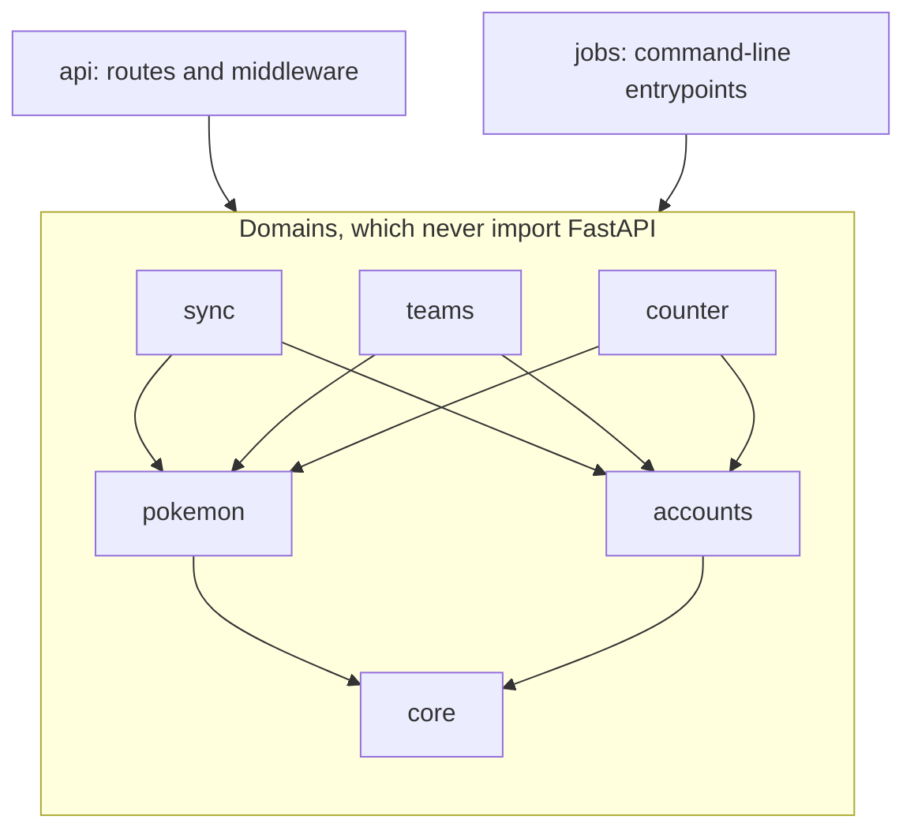
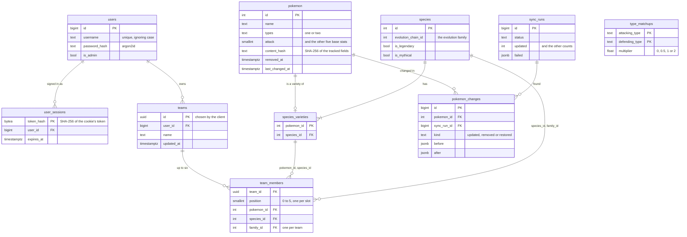
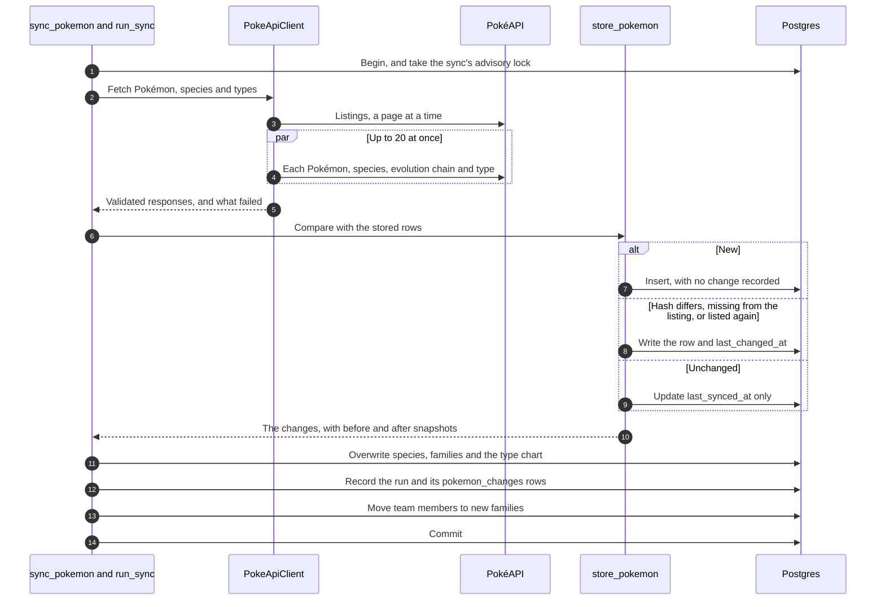

# Counterdex API

Counterdex's backend is a FastAPI app. It keeps a copy of PokéAPI's data in Postgres, serves it,
and stores accounts and teams. This guide covers working on it, and the
[root README](../README.md) explains why it's built this way.

**Contents**

- [Running it](#running-it) and [Settings](#settings)
- [Layout](#layout) and [Conventions](#conventions)
- [Data model](#data-model) and [API at a glance](#api-at-a-glance)
- [Teams](#teams) and [Atomicity and races](#atomicity-and-races)
- [Counter teams](#counter-teams) and [the type chart and legendary flags](#the-type-chart-and-legendary-flags)
- [How the sync works](#how-the-sync-works), including [the team follow-up](#the-team-follow-up)
  and [demoing a change](#demoing-a-change)
- [Migrations](#migrations), [Tests and checks](#tests-and-checks) and
  [the frontend's client](#the-frontends-client)

## Running it

You need uv and Docker. First, from the repo root, create `.env` and start Postgres:

```bash
cp .env.example .env
docker compose up -d --wait
```

Then, from `backend/`, install, migrate, sync and serve:

```bash
uv sync
uv run --env-file ../.env alembic upgrade head
uv run --env-file ../.env python -m app.jobs.sync_pokemon
uv run --env-file ../.env uvicorn app.api.main:app --port 3000 --reload
```

The third command fills the database from PokéAPI, as [How the sync works](#how-the-sync-works)
explains. The interactive docs are then at http://localhost:3000/api/docs.

**Port 3000.** The frontend's Vite server sends `/api` requests to port 3000. Instead of uvicorn,
you can run `vercel dev` from the repo root, after `vercel link`. It serves the API and the app
together, routed as in production. Run only one, since both want the port.

### Jobs

Each job is a module, run from `backend/` with `uv run --env-file ../.env python -m`:

| Job | What it does |
| --- | --- |
| `app.jobs.sync_pokemon` | Brings the database in line with PokéAPI and records what changed. See [How the sync works](#how-the-sync-works). |
| `app.jobs.make_admin USERNAME [--revoke]` | Makes a user an admin, or with `--revoke` takes admin away. |
| `app.jobs.seed_teams USERNAME` | Adds 28 teams to browse, spread over about four weeks: 7 for `USERNAME`, who must already exist, and 21 for 13 users it makes up. Running it again adds nothing. |
| `app.jobs.demo_changes [--not-local]` | Syncs as if PokéAPI had changed, so teams show what changed. See [Demoing a change](#demoing-a-change). |

The last two make up data, so they're guarded:
- **Local only.** They refuse a `DATABASE_URL` that isn't on this machine (`app/jobs/local.py`).
  Only `demo_changes` can skip the check, with `--not-local`.
- **No sign-ins.** The users `seed_teams` makes get random passwords nobody knows, so no one can
  sign in as them.

## Settings

The app reads environment variables only, never `.env` itself. Locally, `--env-file` passes in the
repo root's `.env`. On Vercel, they're the project's environment variables.

| Variable | What it does |
| --- | --- |
| `DATABASE_URL` | The Postgres URL. Plain `postgres://` URLs from Neon and Vercel work too. |
| `DATABASE_URL_UNPOOLED` | Neon's direct URL, which bypasses its PgBouncer pooler (a proxy that shares a few database connections among many clients). Migrations use it when it's set, because schema changes shouldn't go through the pooler. |
| `CACHE_RESPONSES` | `false` sends `no-store` on every response, so changes made by hand show at once. Defaults to `true`. |
| `SECURE_COOKIES` | `false` makes the session a plain cookie named `session`, because Chrome and Safari refuse a `Secure` cookie with a `__Host-` name over http://localhost. Defaults to `true`. |

## Layout

The code is split into domains, which hold the logic, and two entrypoints, `api` and `jobs`, which
call them.

```
app/
  core/        settings, database plumbing and rules for incoming text
  pokemon/     Pokémon, species and the type chart, and the queries that serve them
  accounts/    users, passwords and sign-in sessions
  sync/        keeping the Pokémon tables in step with PokéAPI, and the change history
  teams/       teams and their members
  counter/     counter teams, threats and team-against-team scores, worked out on request
  api/         the FastAPI app: routes, middleware and the docs
  jobs/        command-line jobs: the sync, make_admin, and the local seed and demo jobs
  migrations/  Alembic
tests/         mirrors app/, with shared fixtures in tests/conftest.py
  support/     builders and the fake PokéAPI
```

**Import rules.** Domains know nothing about how they're called. `uv run lint-imports` checks
these rules:
- **Layers.** `core` is at the bottom, and `pokemon` and `accounts` build on it. `sync`, `teams`
  and `counter` build on those, without importing each other.
- **No framework in domains.** Domains never import FastAPI or the entrypoints.
- **Separate entrypoints.** `api` and `jobs` don't import each other.



**One job per file.** Each file in a domain has one job. The last four are the sync's alone.

| File | What it holds |
| --- | --- |
| `models` | Tables |
| `schemas` | The shapes the API takes and serves |
| `types` | Internal data |
| `enums`, `constants`, `exceptions` | What their names say |
| `queries` | Read-only lookups |
| `service` | The domain's operations |
| `client` | The PokéAPI client |
| `pokeapi` | PokéAPI's response shapes |
| `normalize` | Turning those shapes into ours |
| `store` | Writing them |

## Conventions

These rules hold across the codebase.

- **Shared rules.** A rule the API and the database share, such as base stats of 1–255, is one
  constant. Both the validator and the table's CHECK use it.
- **Enums as text.** Enums are `StrEnum`s, stored as text with a CHECK (`text_enum()`). Postgres
  ENUM types aren't used, because they can't drop values.
- **Named constraints.** A naming convention names every constraint, so migrations refer to them
  predictably. When a service needs to know which constraint a write broke, it checks the name
  with `violates_unique` (`app/core/db.py`) against the same constant the table is declared with,
  such as `FAMILY_ON_TEAM` in `app/teams/models.py`. So the two can't drift apart.
- **Errors.** Routes declare their error responses next to the route and turn domain exceptions into
  `HTTPException`s. Responses that several routes share are named once, such as `OWNERS_ONLY` and
  `CONFLICTS` for the teams routes and `NOT_SYNCED` for the counter routes. Every error's `detail`
  says in a sentence what's wrong and, where it helps, what to do. A team's 409 also gives a
  `reason` code, such as `family_on_team`, for clients to act on.
- **No NUL characters.** Postgres can't store NUL, so the API refuses text containing it with a
  422. Put `NO_NUL` (`app/core/text.py`) after a string's other constraints.
- **Caching.** Every response is `no-store` (the `NoStoreByDefault` middleware) unless its route
  calls `cache_publicly`.
- **No suppressions.** No `# noqa` or `# type: ignore`.
- **Settled dependencies.** Take only dependency releases that are at least two weeks old.

## Data model

The tables come in two halves, PokéAPI's and users', which meet in `team_members`.



- **PokéAPI's half.** The sync writes PokéAPI's data (`pokemon`, `species`, `species_varieties`,
  `type_matchups`) and its history (`pokemon_changes`, `sync_runs`).
- **Users' half.** The API writes `users`, `user_sessions`, `teams` and `team_members`, and so do
  the `make_admin` and local seed jobs.
- **Where they meet.** Each member stores its `species_id` and its `family_id` (its species'
  `evolution_chain_id`). Composite foreign keys (foreign keys over two columns together) tie the
  species to the Pokémon (`species_varieties`) and the family to the species (`species`). So a
  sync that moves a Pokémon carries its team members along (see
  [The team follow-up](#the-team-follow-up)).

## API at a glance

Every route is under `/api`. The [interactive docs](https://counterdex.vercel.app/api/docs) list
each route's parameters, responses and errors.

| Area | Routes |
| --- | --- |
| Pokédex | `GET /pokemon` (search, filter, page), `GET /pokemon/{id}`, `GET /pokemon/{id}/changes` |
| Sync | `GET /sync/status`, `GET /sync/runs` (admins only) |
| Accounts | `POST /users` (sign up), `GET`, `POST` and `DELETE /session` (who's signed in, sign in, sign out) |
| Teams | `GET /teams` (everyone's), `GET /users/{username}/teams`, `PUT`, `GET`, `PATCH` and `DELETE /teams/{id}`, `POST /teams/{id}/members`, `PUT` and `DELETE /teams/{id}/members/{pokemon_id}`, `PUT /teams/{id}/order` |
| Counter | `GET /counter-team`, `GET /team-threats`, `GET /matchups` |
| Health | `GET /health` |

## Teams

Anyone can see a team, but only its owner can change it.

- **Owner checks.** Every route that changes an existing team depends on `require_team_owner`. It
  answers 404 or 403, or locks the team's row. [Atomicity and races](#atomicity-and-races)
  explains why.
- **Conflicts.** The service checks the team's rules first, such as one Pokémon per evolution
  family. A broken rule raises `TeamConflictError`, whose reason becomes the 409's `reason`.

**Listing everyone's teams.** `GET /api/teams` lists everyone's teams that have a Pokémon, newest
first, a page at a time. Its filters combine:

| Parameter | What it does |
| --- | --- |
| `q` | Matches a team's name, its owner's username or a member's name, ignoring case. |
| `type` | Requires a member of that type. Repeat it to require one of each. |
| `changed` | Requires a member that a sync changed in the last week. |
| `owner` | Keeps one user's teams, including any with no Pokémon yet, unless another filter needs a Pokémon. |
| `sort=power` | Orders by the sum of the members' base stats instead. |

Power is worked out on read from current stats, using `stat_total()` in `app/pokemon/queries.py`.
So no index serves it, and each page reads every matching team.

## Atomicity and races

Each change to a team runs in one database transaction. The route commits it only once the change
is complete, so it's saved whole or not at all.

**Two changes to one team.** Before the route reads the team, `require_team_owner` locks its row
with `lock_owned_team`, a `SELECT … FOR UPDATE`. The lock holds until the request commits. A
second change to the same team waits for the first, then reads the team the first left. Changes
to different teams don't wait for each other.

**Rules checked after the lock.** The service reads the team only once it holds the lock, so its
checks see the latest members:
- **Full team.** A team of six refuses another Pokémon (409 `team_full`).
- **Family on the team.** A team refuses a second Pokémon from one family (409 `family_on_team`).
- **Out-of-date order.** A reorder must list exactly the current members. So a reorder made
  before someone else's removal is refused (409 `order_out_of_date`), not applied to a team it
  never saw.

**The database as the backstop.** Constraints keep the rules even for a write that skips the
service:
- **One per family.** A unique `(team_id, family_id)` allows one Pokémon per evolution family.
  `_guarded` turns a violation into the same 409 `family_on_team`.
- **Six slots.** A CHECK keeps `position` between 0 and 5, and a unique `(team_id, position)`
  gives each slot one member. So a team can't pass six.
- **Slots checked at commit.** The slot rule is a deferred constraint, which Postgres checks at
  commit rather than after each statement. Deferral lets a reorder, replacement or removal move
  members through each other's slots. Each change that moves members ends with `_check_slots`,
  which checks the rule at once and defers it again. So a clash surfaces inside the change.

**Creating a team.** The client picks the team's UUID and sends `PUT /api/teams/{id}`:
- **Safe to repeat.** If the same request arrives twice, from a retry or a double click, the
  second gets the team the first made.
- **Taken ids.** If another user has the id, the answer is 409 `team_id_taken`. The insert runs in
  a savepoint (a part of a transaction that can be rolled back alone), so the refusal doesn't
  abort the request.
- **No half-made teams.** The new team's Pokémon are added in the same transaction, so a refused
  Pokémon leaves no team behind.

**The sync.** Each run is one transaction under an advisory lock (a lock on a number the app
picks, not on a row). So a run is saved whole or not at all, and two runs never write at once.
[How the sync works](#how-the-sync-works) has the details.

**How it's tested.**
- **`tests/teams/test_races.py`** holds one change's lock uncommitted and starts a second change
  on another connection. Once Postgres shows that connection waiting for a lock (`pg_locks`), it
  commits the first. Then it checks what the second found: a full team, a family already on it,
  or an out-of-date order.
- **`test_a_change_waits_for_one_in_progress_then_sees_it`** (in `tests/api/routes/test_teams.py`)
  does the same through the API.
- **`test_the_database_refuses_a_family_member_the_check_couldnt_see`** adds a Pokémon without the
  lock, to show the constraint refuses it alone.

## Counter teams

Three read-only routes answer from the Pokédex and the type chart alone:

| Route | What it answers |
| --- | --- |
| `GET /api/counter-team` | A team to beat the one given |
| `GET /api/team-threats` | Up to 12 Pokémon that beat it most |
| `GET /api/matchups` | Each of one team's Pokémon scored against each of another's, such as a team being built against the team it's meant to counter |

Teams are given as repeated Pokémon ids.

### Scoring a matchup

A matchup is one Pokémon against another, scored from the first one's side. It uses types and base
stats only, with no moves. The code is in `scoring.py`, and the weights are in `constants.py`.

| Part | Points |
| --- | --- |
| **Offense** | Log2 of its best type's multiplier against the opponent. 4× is +2, 2× +1, 1× 0, ½× −1, ¼× −2, and no effect −3. |
| **Defense** | The opponent's best type against it, scored the same way and subtracted. |
| **Power** | ±0.25 for each 100 of base stat total between them, in proportion. A 50-point gap is ±0.125. |
| **Speed** | ±0.25 for being faster or slower. |

- **Types usually decide.** Types move the score by whole points and stats by quarters. A type's
  edge usually decides a matchup, but a big enough gap in stats can outweigh it.
- **Ratings.** A score of 0.75 or more is `good`, −0.75 or less is `bad`, and anything between is
  `even`. So a one-point type edge stays good unless the stats take back more than a quarter of it.
- **Reasons.** Each matchup includes the parts it's scored from (`attack`, `opponent_attack`,
  `speed` and `stat_total_difference`), so a client can say why it's good.
- **Rounding.** Scores are rounded to 9 decimals, so scores equal on paper compare equal. The
  tie-breaks below then decide, not float rounding.

### Choosing the counter team

`search.py` chooses the counter team one Pokémon at a time. Each pick is the one that most raises
the team's score.

- **The team's score.** Add up the team's best score against each of their Pokémon. Take off a
  point for each of their types that three or more of the team are weak to. One of theirs could
  beat all of those.
- **Ties.** Ties go to the higher total score against their team, then the higher base stat
  total, then the lower id. So a team always gets the same answer from the same data.
- **Who can be picked.** Picks come from different evolution families, so the result can be saved.
  They come only from Pokémon PokéAPI lists. Alternate forms and legendary and mythical Pokémon
  count only when asked for (`forms=true`, `legendaries=true`).
- **Battle order.** First comes the Pokémon that scores best against their lead. The rest follow
  in the order of the opponents they each score best against.

Picking one at a time can miss the best possible six, but finding those would mean scoring every
set of six from the whole Pokédex. Picking one at a time is quick and gives the same answer every
time. It also lets each pick be explained by its matchups.

**Why these numbers.** The weights are picked by hand, because there's no battle data to fit them
to. Each one is checked against the synced Pokédex. For example, a stat gap only outweighs a whole
type step in 0.6% of pairs, so types decide most matchups. The reason for every number is written
next to it in `app/counter/constants.py`, and the root README sums them up in
[Why it's scored this way](../README.md#why-its-scored-this-way).

**The threats** are up to 12 Pokémon with the highest total score against the team, each evolution
family once, by its best. The team's own families are left out, even a removed member's. So the
team's Pokémon and their evolutions never come back as threats to it.

### Worked out on request

Nothing is worked out in advance. A team can be any one to six of about 1,350 Pokémon,
and a sync can also change the stats and types behind a score.

- **Per request.** A request reads the type chart and the Pokémon it can choose from. It then
  scores each of them against at most six, in memory.
- **Caching.** Responses are cached like the Pokédex's (`COUNTER_TEAM_CACHE_CONTROL`), since the
  same ids get the same answer until a sync changes the data.
- **Before a sync.** Until a sync has stored the type chart, the routes answer 503 and say to run
  one. The counter team also answers 503 while there are fewer evolution families to choose from
  than the team has Pokémon.
- **Bad ids.** An unknown id, or one given twice on a team, is a 422.

## The type chart and legendary flags

Two pieces of PokéAPI data exist only for the counter routes.

**The type chart.** `type_matchups` has one row for each pair of the 18 types, 324 in all. Each
row gives the share of damage a move of the attacking type does to a Pokémon of the defending
type. The share is 0, ½, 1 or 2. A Pokémon with two types takes the product of both rows, so Rock
against Charizard (Fire/Flying) is 2 × 2 = 4×. The chart is how a Pokémon's weaknesses,
resistances and immunities are worked out. It's stored rather than written into the code,
because it's PokéAPI's data like the rest and every sync refreshes it. Checks allow only known
types and the four multipliers.

**Legendary and mythical flags.** `species.is_legendary` and `species.is_mythical` mark species
such as Mewtwo and Mew. The counter search leaves them out unless `legendaries=true`, so it
suggests Pokémon a player would usually field. PokéAPI doesn't flag Paradox Pokémon or Ultra
Beasts, so they count as regular Pokémon.

## How the sync works

The sync copies PokéAPI into Postgres and records what changed, in one transaction.
`python -m app.jobs.sync_pokemon` (`app/jobs/sync_pokemon.py`) runs `run_sync`
(`app/sync/service.py`), then [the team follow-up](#the-team-follow-up), and commits them together.



### What it fetches

`PokeApiClient` (`app/sync/client.py`) makes about 3,000 requests a run:
- **Listings.** The `pokemon` and `pokemon-species` listings, `PAGE_SIZE` (200) entries a page.
- **Details.** Every Pokémon, every species, and each evolution chain the species belong to, once
  per chain. Each species also brings its legendary and mythical flags.
- **Types.** The 18 types, whose damage relations become the type chart.

The client validates every response with Pydantic (`pokeapi.py`), and `normalize.py` turns them
into our shapes. The client only requests URLs on PokéAPI, and it doesn't follow redirects.

Whatever is missing from a listing counts as removed. So a listing that fails or can't be trusted,
such as one that loops or runs past `MAX_PAGES`, fails the sync.

### Fair use

The client limits its load on PokéAPI (`app/sync/constants.py`):
- **User agent.** Every request sends `USER_AGENT`, which names the app and links to its repo.
- **Concurrency.** At most `CONCURRENT_REQUESTS` (20) requests are in flight, each with a timeout
  of `REQUEST_TIMEOUT_SECONDS` (15).
- **Retries.** The client retries only rate limiting, server errors (`RETRYABLE_STATUS_CODES`:
  429, 500, 502, 503 and 504) and network failures. A request gets up to `MAX_ATTEMPTS` (3) tries
  in all. The first retry waits `RETRY_DELAY_SECONDS` (0.5), and each later one twice as long as
  the last.
- **Retry-After.** A 429 or 503 whose `Retry-After` asks for a number of seconds gets that wait
  instead, up to `MAX_RETRY_AFTER_SECONDS` (30).

PokéAPI answers from Cloudflare's cache with `max-age=86400` (one day). So syncing more than once
a day can't see newer data.

### How changes are detected and stored

`store_pokemon` (`app/sync/store.py`) compares each fetched Pokémon with its row. It tracks the
Pokémon's columns (name, types, base stats, sprite and default-form flag), hashed with SHA-256 into
`content_hash`.

| Kind | When | Recorded as a change? |
| --- | --- | --- |
| **New** | Not stored yet | No, since no team can have it yet |
| **Updated** | The hash differs | Yes |
| **Removed** | Stored and not yet removed, but missing from PokéAPI's listing | Yes |
| **Restored** | Marked removed, and listed again | Yes |

- **Removed rows stay.** A removed row gets `removed_at` and is never deleted, so teams keep it.
  A Pokémon whose fetch failed is left as it was, since only the listing decides what's removed.
- **Changes.** Each change is a row in `pokemon_changes`, with snapshots of the tracked fields from
  before and after (a removal has no `after`). It also sets the Pokémon's `last_changed_at`, which
  the `changed` filters and `changed_recently` read.
- **Runs.** Each run is a row in `sync_runs`, with its counts and what failed.
  `GET /api/sync/status` serves when the data last synced and how the latest run went.
- **Reference data.** Species, evolution families and the type chart are overwritten without
  history. A family is stored only if all its species and its chain were fetched, and the type
  chart only if all 18 types were. Otherwise what was stored before stays.

### Safeguards

A bad sync would flag every team, so the job guards against one:
- **Too many removals.** A sync that would remove more than `MAX_REMOVED_SHARE` (5%) of the stored
  Pokémon, or `MIN_REMOVALS_ALLOWED` (10) if that's more, raises `SuspiciousRemovalError`. A
  broken listing is likelier than that many real removals.
- **One at a time.** `run_sync` first takes a transaction-level advisory lock on `SYNC_LOCK_KEY`,
  held until the transaction ends. A second sync raises `SyncAlreadyRunningError`.
- **All or nothing.** The data, its changes and the run's record are saved together or not at
  all. On any error the job rolls back, records a failed run with the error, and exits 1.
- **Partial failures.** If a Pokémon, species, chain or type still fails after retrying, the rest
  is saved. The run lists what failed, the job exits 1, and the next run fills the gaps.

### The team follow-up

The follow-up keeps each team member in its species' evolution family. After `run_sync`, the job
calls `follow_species_families` (`app/teams/service.py`) in the same transaction.

When PokéAPI moves a Pokémon to a species in another family:
1. Its members' `species_id` follows through the cascading foreign key to `species_varieties`.
2. `follow_species_families` moves their `family_id` to the new species' family.

The foreign key to `species` is checked at commit, so a member can be out of step in between.

**Clashes fail the run.** A move that would put two Pokémon from one family on a team breaks the
unique `(team_id, family_id)`. The run then fails, is rolled back and is recorded as failed.
Otherwise the sync would have to choose which Pokémon to take off someone's team.

### Running a sync

```bash
uv run --env-file ../.env python -m app.jobs.sync_pokemon
```

It logs a summary and exits 0 only if nothing failed. Nothing schedules it yet (`vercel.json` has
no cron). To sync production, run it by hand with production's `DATABASE_URL`. Once a day is the
natural cadence, given PokéAPI's one-day cache.

### Demoing a change

PokéAPI rarely changes, so `python -m app.jobs.demo_changes` makes it look as if it had. Use it for
a demo, or for working on how changes are shown.

It runs the real job through `ChangedPokeApi` (`app/jobs/demo_changes.py`), an httpx2 transport.
The transport passes each request to PokéAPI and edits the Pokémon in the response, as the `DEMO`
constant says:
- **Charizard** gains 20 Attack and 20 Speed.
- **Gengar** becomes Ghost/Fairy.
- **Pikachu** leaves the listing.
- **Garchomp, Snorlax, Lucario and Dragonite** get smaller stat changes.

Everything from the client on is the real sync. So the demo shows detection, snapshots,
`last_changed_at` and the teams' alerts working together, not rows written by hand.

- **Undoing it.** The next ordinary sync puts PokéAPI's data back and records that too. The six
  are updated again and Pikachu is restored, so each kind of change can be shown.
- **Local by default.** Like `seed_teams`, it refuses a database that isn't on this machine.
  `--not-local` lets it demo a deployed app. The deployed database then keeps the made-up changes
  in its history, and serves the made-up data until its next ordinary sync.
- **Tested.** `tests/jobs/test_demo_changes.py` runs a similar scenario, both syncs and all,
  against the fake PokéAPI, which serves only Charizard's and Pikachu's families.

### Admins and the run history

Admins can see the history of every sync run.

- **Admins.** `users.is_admin` marks admins, and `GET /api/session` includes it.
- **History.** `GET /api/sync/runs` lists every sync run, newest first, a page at a time (`page`,
  `page_size`). It gives the total, so a page can say "Page 2 of 5".
- **Access.** Its `require_admin` dependency answers 401 to visitors and 403 to users who aren't
  admins.

Grant admin from the command line, or take it away with `--revoke`:

```bash
uv run --env-file ../.env python -m app.jobs.make_admin USERNAME
```

## Migrations

Alembic manages the schema. To add a migration and apply it:

```bash
uv run --env-file ../.env alembic revision --autogenerate -m "store something"
uv run --env-file ../.env alembic upgrade head
```

- **New files.** They're date-prefixed, and ruff lints and formats them as they're written.
- **Tests.** Tests check that the migrations match the models, including the CHECK constraints
  autogenerate can't see, and that they downgrade cleanly.
- **Deploys.** Nothing runs migrations on deploy. Run production's by hand, over Neon's direct
  URL.
- **Deferred constraints.** Two team constraints are checked at commit. One is the unique slot
  ([Atomicity and races](#atomicity-and-races)). The other is the member's foreign key to its
  species' family ([The team follow-up](#the-team-follow-up)).
  `check_a_team_members_family_at_commit` makes the second deferrable with a hand-written
  `alter constraint`.

## Tests and checks

Four commands check the backend:

```bash
uv run pytest                                      # needs Docker
uv run ruff check . && uv run ruff format --check .
uv run mypy app tests                              # strict
uv run lint-imports
```

- **Database.** Database tests start a throwaway Postgres 17 container on first use
  (Testcontainers) and migrate it. Each test runs in a transaction that's rolled back. Tests of
  pure logic don't start it.
- **No network.** pytest-socket fails any test that connects to anything but localhost and
  Docker's socket.
- **Fake PokéAPI.** `tests/support/pokeapi.py` serves recorded responses from
  `tests/support/pokeapi_responses` through a mock transport. They cover Charizard's and Pikachu's
  families, and all 18 types. A test can make requests fail or edit the responses.
- **Races.** Race tests commit on two real connections, as
  [Atomicity and races](#atomicity-and-races) describes.
- **A lean suite.** About 600 tests run in under ten seconds. Each behavior is tested once, at the
  level that shows it best. Rules are tested in the service, and status codes, messages and
  caching through the routes.
- **Cheap hashing.** Tests hash passwords with cheap Argon2 settings, except
  `tests/accounts/test_passwords.py`, which checks the real ones. Real hashing would take a
  quarter of the run.
- **Shared fixtures.** `pokedex` (the type chart and a set of real Pokémon with their species and
  families, as a sync stores them) and `sessions` live in `tests/conftest.py`. Builders such as
  `remove_pokemon` and `change_recently` are in `tests/support/pokemon.py`.
- **Complete docs.** One test checks that every route and every parameter has a description.

## The frontend's client

The frontend's API client is generated from this app's OpenAPI schema. After changing a route or a
schema, run `npm run api:generate` in `frontend/`. `tests/api/test_export_openapi.py` fails until
you do.
