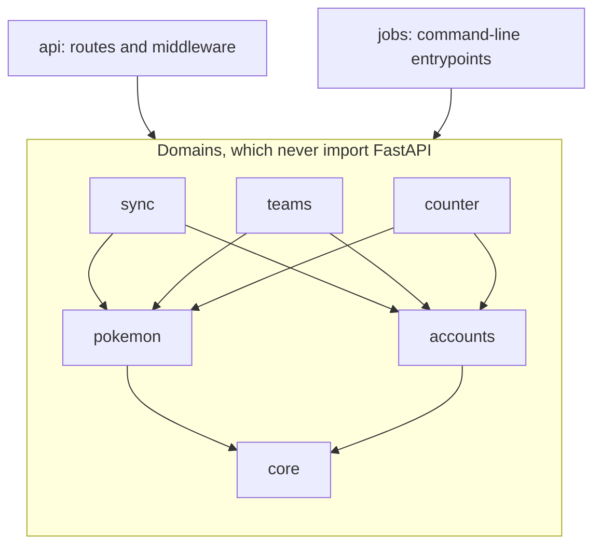
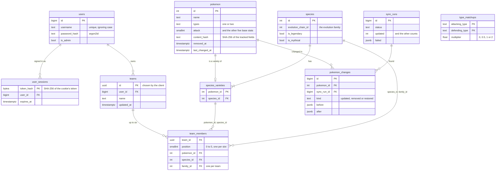
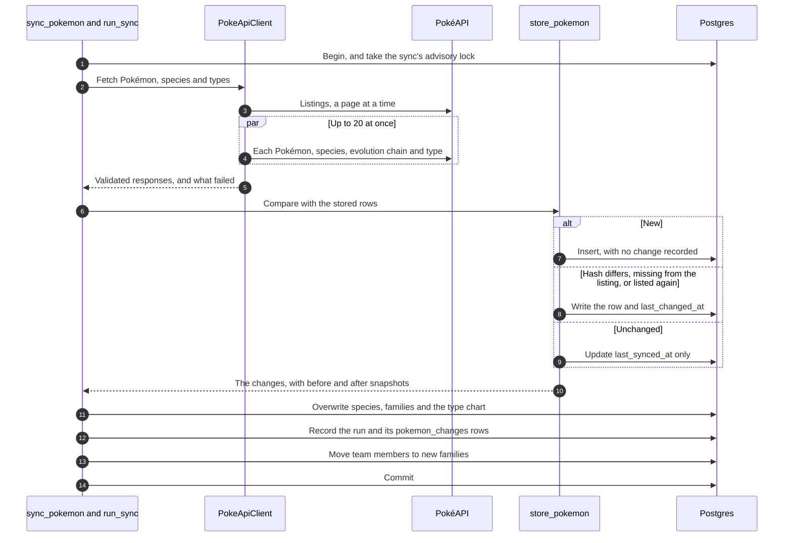

# Counterdex API

Counterdex's backend is a FastAPI app. It keeps a copy of PokéAPI's data in Postgres, serves that
data, and stores accounts and teams. This guide is for working on the backend. The
[root README](../README.md) explains why it's built the way it is.

## Contents

- [Running it](#running-it) and [Settings](#settings)
- [Layout](#layout) and [Conventions](#conventions)
- [Data model](#data-model) and [API at a glance](#api-at-a-glance)
- [Teams](#teams) and [Atomicity and races](#atomicity-and-races)
- [Counter teams](#counter-teams) and
  [the type chart and legendary flags](#the-type-chart-and-legendary-flags)
- [How the sync works](#how-the-sync-works), including [the team follow-up](#the-team-follow-up)
  and [demoing a change](#demoing-a-change)
- [Migrations](#migrations), [Tests and checks](#tests-and-checks) and
  [the frontend's client](#the-frontends-client)

## Running it

You'll need uv and Docker. Start in the repository's root folder, where these two commands create
your `.env` file and start Postgres.

```bash
cp .env.example .env
docker compose up -d --wait
```

Then move to the `backend/` folder. These commands install the dependencies, create the tables,
load PokéAPI's data and start the server.

```bash
uv sync
uv run --env-file ../.env alembic upgrade head
uv run --env-file ../.env python -m app.jobs.sync_pokemon
uv run --env-file ../.env uvicorn app.api.main:app --port 3000 --reload
```

The third command fills the database from PokéAPI, as [How the sync works](#how-the-sync-works)
explains. Once the server is running, the interactive API docs are at
http://localhost:3000/api/docs.

The server uses port 3000 because the frontend's Vite dev server forwards `/api` requests there.
Instead of uvicorn, you can run `vercel dev` from the repository root, after running `vercel link`
once. It serves the API and the app together, routed the same way as in production. Only run one
of the two, because both want port 3000.

### Jobs

Each job is a Python module. You run one from `backend/` by putting its name after
`uv run --env-file ../.env python -m`.

| Job | What it does |
| --- | --- |
| `app.jobs.sync_pokemon` | Brings the database in line with PokéAPI and records what changed. See [How the sync works](#how-the-sync-works). |
| `app.jobs.make_admin USERNAME [--revoke]` | Makes a user an admin. With `--revoke`, it takes admin away instead. |
| `app.jobs.seed_teams USERNAME` | Adds 28 teams to browse, spread over about four weeks. Seven belong to `USERNAME`, who must already have an account, and the other 21 belong to 13 users that the job makes up. Running it again adds nothing. |
| `app.jobs.demo_changes [--not-local]` | Runs a sync as if PokéAPI had changed, so teams show what changed. See [Demoing a change](#demoing-a-change). |

The last two jobs make up data, so they have guards. They refuse to run against a `DATABASE_URL`
that isn't on this machine (the check is in `app/jobs/local.py`), and only `demo_changes` can skip
that check, with `--not-local`. The users that `seed_teams` creates get random passwords that
nobody knows, so no one can sign in as them.

## Settings

The app only reads environment variables. It never reads the `.env` file itself. Locally,
`--env-file` passes in the variables from the `.env` file in the repository root. On Vercel, they
come from the project's environment variables.

| Variable | What it does |
| --- | --- |
| `DATABASE_URL` | The Postgres URL. Plain `postgres://` URLs from Neon and Vercel work too. |
| `DATABASE_URL_UNPOOLED` | Neon's direct URL, which bypasses its PgBouncer pooler (a proxy that shares a few database connections among many clients). When it's set, migrations use it, because schema changes shouldn't go through the pooler. |
| `CACHE_RESPONSES` | Set it to `false` to send `no-store` on every response, so changes you make by hand show up at once. It defaults to `true`. |
| `SECURE_COOKIES` | Set it to `false` to make the session a plain cookie named `session`. You need this locally, because Chrome and Safari refuse a `Secure` cookie with a `__Host-` name over http://localhost. It defaults to `true`. |

## Layout

The code is split into domains, which hold the logic, and two entrypoints, `api` and `jobs`, which
call the domains.

```
app/
  core/        settings, database plumbing and rules for incoming text
  pokemon/     Pokémon, species and the type chart, and the queries that serve them
  accounts/    users, passwords and sign-in sessions
  sync/        keeping the Pokémon tables in step with PokéAPI, and the change history
  teams/       teams and their members
  counter/     counter teams, threats and team-against-team scores, worked out on request
  api/         the FastAPI app: routes, middleware and the docs
  jobs/        command-line jobs: the sync, make_admin, and the local seed and demo jobs
  migrations/  Alembic
tests/         mirrors app/, with shared fixtures in tests/conftest.py
  support/     builders and the fake PokéAPI
```

### Import rules

Domains know nothing about how they're called. Running `uv run lint-imports` checks three rules.

- `core` is the bottom layer, and `pokemon` and `accounts` build on it. `sync`, `teams` and
  `counter` build on those two, and they don't import each other.
- Domains never import FastAPI or the entrypoints.
- `api` and `jobs` don't import each other.



### What each file holds

Each file in a domain has a single purpose, and its name tells you what that is. The last four
files in this table only exist in the sync domain.

| File | What it holds |
| --- | --- |
| `models` | Tables |
| `schemas` | The shapes the API accepts and sends back |
| `types` | Internal data |
| `enums`, `constants`, `exceptions` | What their names say |
| `queries` | Read-only lookups |
| `service` | The domain's operations |
| `client` | The PokéAPI client |
| `pokeapi` | The shapes of PokéAPI's responses |
| `normalize` | Turning PokéAPI's shapes into ours |
| `store` | Writing them to the database |

## Conventions

These rules apply across the whole codebase.

- A rule that the API and the database share, such as base stats being between 1 and 255, lives
  in one constant. The validator and the table's CHECK constraint both use it.
- Enums are `StrEnum`s, stored as text with a CHECK constraint (`text_enum()`). Postgres ENUM
  types aren't used, because you can't drop values from them.
- A naming convention gives every constraint a predictable name, so migrations can refer to them.
  When a service needs to know which constraint a write broke, it passes `violates_unique`
  (`app/core/db.py`) the same constant the table is declared with, such as `FAMILY_ON_TEAM` in
  `app/teams/models.py`. That way the two can't drift apart.
- Routes declare their error responses right next to the route, and they turn domain exceptions
  into `HTTPException`s. Error responses that several routes share are defined once, such as
  `OWNERS_ONLY` and `CONFLICTS` for the teams routes and `NOT_SYNCED` for the counter routes.
  Every error's `detail` is a sentence that says what's wrong and, where it helps, what to do
  about it. A 409 from the teams routes also includes a `reason` code, such as `family_on_team`,
  that clients can act on.
- Postgres can't store the NUL character, so the API refuses any text that contains it with a 422.
  To get this check, put `NO_NUL` (`app/core/text.py`) after a string's other constraints.
- Every response is sent with `no-store` (by the `NoStoreByDefault` middleware) unless its route
  calls `cache_publicly`.
- The code has no `# noqa` or `# type: ignore` comments.
- A new dependency release is only taken once it's at least two weeks old.

## Data model

The tables come in two halves, PokéAPI's data and users' data, and the halves meet in
`team_members`.



The sync writes PokéAPI's half. That's the data itself (`pokemon`, `species`, `species_varieties`
and `type_matchups`) and its history (`pokemon_changes` and `sync_runs`).

The API writes the users' half, which is `users`, `user_sessions`, `teams` and `team_members`. The
`make_admin` job and the local seed job write to it too.

Each row in `team_members` stores the member's `species_id` and its `family_id`, which is its
species' `evolution_chain_id`. Composite foreign keys (foreign keys over two columns together) tie
the species to the Pokémon, through `species_varieties`, and the family to the species, through
`species`. So when a sync moves a Pokémon, its team members move along with it (see
[The team follow-up](#the-team-follow-up)).

## API at a glance

Every route is under `/api`. The [interactive docs](https://counterdex.vercel.app/api/docs) list
each route's parameters, responses and errors.

| Area | Routes |
| --- | --- |
| Pokédex | `GET /pokemon` (search, filter, page), `GET /pokemon/{id}`, `GET /pokemon/{id}/changes` |
| Sync | `GET /sync/status`, `GET /sync/runs` (admins only) |
| Accounts | `POST /users` (sign up), `GET`, `POST` and `DELETE /session` (who's signed in, sign in, sign out) |
| Teams | `GET /teams` (everyone's), `GET /users/{username}/teams`, `PUT`, `GET`, `PATCH` and `DELETE /teams/{id}`, `POST /teams/{id}/members`, `PUT` and `DELETE /teams/{id}/members/{pokemon_id}`, `PUT /teams/{id}/order` |
| Counter | `GET /counter-team`, `GET /team-threats`, `GET /matchups` |
| Health | `GET /health` |

## Teams

Anyone can see a team, but only its owner can change it.

Every route that changes an existing team depends on `require_team_owner`. It answers 404 if the
team doesn't exist and 403 if it belongs to someone else. Otherwise it locks the team's row, and
[Atomicity and races](#atomicity-and-races) explains why.

Before making a change, the service checks the team's rules, such as allowing only one Pokémon
from each evolution family. If a change breaks a rule, the service raises `TeamConflictError`, and
that error's reason becomes the `reason` in the 409 response.

### Listing everyone's teams

`GET /api/teams` lists everyone's teams that have at least one Pokémon, newest first, one page at a
time. You can combine its filters.

| Parameter | What it does |
| --- | --- |
| `q` | Matches a team's name, its owner's username or a member's name, ignoring case. |
| `type` | Keeps teams with a member of that type. Repeat it to require a member of each type. |
| `changed` | Keeps teams with a member that a sync changed in the last week. |
| `owner` | Keeps one user's teams. This includes teams with no Pokémon yet, unless another filter needs a Pokémon. |
| `sort=power` | Orders teams by the sum of their members' base stats instead. |

Power is worked out from current stats each time the teams are read, using `stat_total()` in
`app/pokemon/queries.py`. That means no index can serve it, so each page reads every matching team.

## Atomicity and races

Each change to a team runs in a single database transaction. The route only commits it once the
change is complete, so the change is saved whole or not at all.

The sync works the same way. Each run is one transaction, held under an advisory lock (a lock on a
number the app picks, rather than on a row). So a run is saved whole or not at all, and two runs
never write at the same time. [How the sync works](#how-the-sync-works) has the details.

### Two changes to one team

Before the route reads the team, `require_team_owner` locks the team's row with `lock_owned_team`,
which runs a `SELECT … FOR UPDATE`. The lock holds until the request commits. If a second change
to the same team arrives in the meantime, it waits for the first to finish and then reads the team
as the first change left it. Changes to different teams don't wait for each other.

The service only reads the team once it holds the lock, so its checks always see the latest
members. Three rules depend on this.

- A team of six refuses another Pokémon (409 `team_full`).
- A team refuses a second Pokémon from the same family (409 `family_on_team`).
- A reorder must list exactly the current members. So if someone else removed a member after you
  made your reorder, your reorder is refused (409 `order_out_of_date`) rather than applied to a
  team it never saw.

### The database as a backstop

Database constraints enforce the rules even for a write that skips the service.

- A unique constraint on `(team_id, family_id)` allows only one Pokémon per evolution family. If
  a write breaks it, `_guarded` turns the error into the same 409 `family_on_team`.
- A CHECK constraint keeps `position` between 0 and 5, and a unique constraint on
  `(team_id, position)` gives each slot one member. Together they mean a team can't have more than
  six members.
- The slot rule is a deferred constraint, which means Postgres checks it at commit instead of after
  each statement. Deferring it lets a reorder, replacement or removal move members through each
  other's slots along the way. Every change that moves members ends by calling `_check_slots`,
  which checks the rule straight away and then defers it again. That way a clash shows up inside
  the change that caused it.

### Creating a team

The client picks the team's UUID itself and sends `PUT /api/teams/{id}`.

- The request is safe to repeat. If it arrives twice, from a retry or a double click, the second
  request gets back the team that the first one made.
- If another user already has that id, the answer is 409 `team_id_taken`. The insert runs in a
  savepoint (a part of a transaction that can be rolled back on its own), so the refusal doesn't
  abort the rest of the request.
- The new team's Pokémon are added in the same transaction. If one of them is refused, no
  half-made team is left behind.

### How it's tested

These tests check that the locking works.

- `tests/teams/test_races.py` holds one change's lock without committing, and starts a second
  change on another connection. Once Postgres shows that connection waiting for a lock (in
  `pg_locks`), the test commits the first change. Then it checks what the second change found,
  which is a full team, a family already on the team, or an out-of-date order.
- `test_a_change_waits_for_one_in_progress_then_sees_it` (in `tests/api/routes/test_teams.py`)
  does the same through the API.
- `test_the_database_refuses_a_family_member_the_check_couldnt_see` adds a Pokémon without taking
  the lock, to show that the constraint refuses it on its own.

## Counter teams

Three read-only routes work out their answers from the Pokédex and the type chart alone.

| Route | What it answers |
| --- | --- |
| `GET /api/counter-team` | A team to beat the one given |
| `GET /api/team-threats` | Up to 12 Pokémon that do best against the team given |
| `GET /api/matchups` | Each Pokémon on one team scored against each Pokémon on another, such as a team you're building against the team it's meant to counter |

You pass a team to these routes as repeated Pokémon ids.

### Scoring a matchup

A matchup is one Pokémon against another, scored from the first Pokémon's side. It uses only
types and base stats, because the data has no moves. The code is in `scoring.py`, and the weights
are in `constants.py`. The score adds up four parts.

| Part | Points |
| --- | --- |
| Offense | Log2 of the multiplier for the Pokémon's best type against the opponent, so every doubling is one point. 4× is +2, 2× is +1, 1× is 0, ½× is −1, ¼× is −2, and no effect is −3. |
| Defense | The opponent's best type against the Pokémon, scored the same way and then subtracted. |
| Power | Plus or minus 0.25 for every 100 points of difference in base stat total, in proportion. A 50-point gap is worth 0.125. |
| Speed | Plus 0.25 for being faster, minus 0.25 for being slower, and 0 for a tie. |

Types move the score by whole points, and stats only by quarters. So a type advantage usually
decides a matchup, but a big enough gap in stats can outweigh it.

A score of 0.75 or more is rated `good`, −0.75 or less is `bad`, and anything in between is
`even`. So a one-point type advantage stays good unless the stats take back more than a quarter of
it.

Each matchup includes the parts it was scored from (`attack`, `opponent_attack`, `speed` and
`stat_total_difference`), so a client can explain why it's good.

Scores are rounded to 9 decimal places, so scores that are equal on paper also compare as equal.
That way the tie-breaks described below decide the order, not floating-point rounding.

### Choosing the counter team

`search.py` builds the counter team one Pokémon at a time. Each time, it adds the Pokémon that
raises the counter team's score the most.

The counter team's score works like this. For each Pokémon on the other team, take the counter
team's best score against it, and add those up. Then take off a point for each of the other team's
types that three or more of the counter team's Pokémon are weak to, because one opposing Pokémon
of that type could beat all of them.

Ties go to the Pokémon with the higher total score against the other team, then the higher base
stat total, then the lower id. So the same team always gets the same answer from the same data.

Picks come from different evolution families, so the counter team can be saved as a real team.
They only come from Pokémon that PokéAPI currently lists. Alternate forms, and legendary and
mythical Pokémon, are only included when the request asks for them (`forms=true` and
`legendaries=true`).

The finished team comes back in battle order. First comes the Pokémon that scores best against the
other team's lead, which is its first Pokémon. The rest follow in the order of the opponents they
each score best against.

Picking one at a time can miss the best possible six. But finding those would mean scoring every
set of six from the whole Pokédex. Picking one at a time is quick, gives the same answer every
time, and lets each pick be explained by its matchups.

### Why these numbers

The weights are picked by hand, because there's no battle data to fit them to. Each one is checked
against the synced Pokédex. For example, a stat gap only outweighs a whole type step in 0.6% of
pairs, so types decide most matchups. The reason for every number is written next to it in
`app/counter/constants.py`. The root README sums them up in
[How the scoring works, and why](../README.md#how-the-scoring-works-and-why).

### Threats

The threats to a team are up to 12 Pokémon with the highest total score against it. Each
evolution family appears at most once, through its best-scoring Pokémon. The team's own families
are left out, including the family of a member that PokéAPI has removed. So the team's Pokémon and
their evolutions never show up as threats to it.

### Worked out on request

Nothing is worked out in advance. A team can be any one to six of about 1,350 Pokémon, and a sync
can also change the stats and types behind a score.

Each request reads the type chart and the Pokémon it can choose from. It then scores each of them
against the team's Pokémon (six at most), all in memory.

Responses are cached the same way as the Pokédex's (`COUNTER_TEAM_CACHE_CONTROL`), since the same
ids get the same answer until a sync changes the data.

Until a sync has stored the type chart, the routes answer 503 and say to run one. The counter team
route also answers 503 when there are fewer evolution families to choose from than the team has
Pokémon.

An unknown id, or an id given twice for one team, gets a 422.

## The type chart and legendary flags

Two pieces of PokéAPI data are stored only for the counter routes.

The type chart lives in `type_matchups`, which has one row for each pair of the 18 types, 324 rows
in all. Each row gives the share of damage that a move of the attacking type does to a Pokémon of
the defending type. The share is 0, ½, 1 or 2. A Pokémon with two types takes the product of both
rows, so Rock against Charizard (Fire/Flying) is 2 × 2 = 4×. The chart is how the app works out a
Pokémon's weaknesses, resistances and immunities. It's stored in the database rather than written
into the code, because it's PokéAPI's data like everything else, and every sync refreshes it. CHECK
constraints allow only known types and the four multipliers.

The legendary and mythical flags are `species.is_legendary` and `species.is_mythical`, and they
mark species such as Mewtwo and Mew. The counter search leaves those species out unless the request
sets `legendaries=true`, so that it suggests Pokémon a player would usually bring to a battle.
PokéAPI doesn't flag Paradox Pokémon or Ultra Beasts, so they count as regular Pokémon.

## How the sync works

The sync copies PokéAPI into Postgres and records what changed, all in one transaction. Running
`python -m app.jobs.sync_pokemon` (`app/jobs/sync_pokemon.py`) calls `run_sync`
(`app/sync/service.py`), then runs [the team follow-up](#the-team-follow-up), and commits both
together.



### What it fetches

`PokeApiClient` (`app/sync/client.py`) makes about 3,000 requests each run.

- It reads the `pokemon` and `pokemon-species` listings, `PAGE_SIZE` (200) entries per page.
- It fetches every Pokémon, every species, and each evolution chain the species belong to, once
  per chain. Each species also brings its legendary and mythical flags.
- It fetches the 18 types, whose damage relations become the type chart.

The client checks every response against a Pydantic model (in `pokeapi.py`), and `normalize.py`
turns the responses into the app's own shapes. The client only requests URLs on PokéAPI, and it
doesn't follow redirects.

Any Pokémon missing from a listing counts as removed. So if a listing fails or can't be trusted,
for example because it loops or runs past `MAX_PAGES`, the whole sync fails.

### Fair use

The client limits how much load it puts on PokéAPI. The settings for this are in
`app/sync/constants.py`.

- Every request sends `USER_AGENT`, which names the app and links to its repository.
- At most `CONCURRENT_REQUESTS` (20) requests are in flight at once, and each one times out after
  `REQUEST_TIMEOUT_SECONDS` (15).
- The client only retries rate limiting, server errors and network failures. The status codes it
  retries are listed in `RETRYABLE_STATUS_CODES`, and they're 429, 500, 502, 503 and 504. A
  request gets up to `MAX_ATTEMPTS` (3) tries in all. The first retry waits `RETRY_DELAY_SECONDS`
  (0.5 seconds), and each later retry waits twice as long as the one before.
- If a 429 or 503 response has a `Retry-After` header asking for a number of seconds, the client
  waits that long instead, up to `MAX_RETRY_AFTER_SECONDS` (30).

PokéAPI answers from Cloudflare's cache with `max-age=86400` (one day). So syncing more than once a
day can't pick up newer data.

### How changes are detected and stored

`store_pokemon` (`app/sync/store.py`) compares each fetched Pokémon with its stored row. It tracks
the Pokémon's name, types, base stats, sprite and default-form flag. Those columns are hashed with
SHA-256 into `content_hash`. A hash is a fingerprint of the data, so a different hash means
something changed.

| Kind | When it happens | Recorded as a change? |
| --- | --- | --- |
| New | The Pokémon isn't stored yet | No, because no team can have it yet |
| Updated | The hash is different | Yes |
| Removed | It's stored and not already removed, but it's missing from PokéAPI's listing | Yes |
| Restored | It was marked removed, and it's listed again | Yes |

A removed row gets a `removed_at` timestamp and is never deleted, so teams keep their Pokémon. If a
Pokémon's fetch failed, its row is left as it was, because only the listing decides what's removed.

Each change becomes a row in `pokemon_changes`, with snapshots of the tracked fields before and
after the change (a removal has no `after`). It also sets the Pokémon's `last_changed_at`, which
the `changed` filters and `changed_recently` read.

Each run becomes a row in `sync_runs`, with its counts and a list of what failed.
`GET /api/sync/status` reports when the data last synced and how the latest run went.

Species, evolution families and the type chart are reference data, and they're overwritten without
keeping any history. A family is only stored if all its species and its chain were fetched, and the
type chart is only stored if all 18 types were. Otherwise the previously stored version stays.

### Safeguards

A bad sync would flag every team, so the job guards against one in four ways.

- If a sync would remove more than `MAX_REMOVED_SHARE` (5%) of the stored Pokémon, or
  `MIN_REMOVALS_ALLOWED` (10) if that's more, it raises `SuspiciousRemovalError`. A broken listing
  is more likely than that many real removals.
- Only one sync runs at a time. `run_sync` first takes a transaction-level advisory lock on
  `SYNC_LOCK_KEY`, which it holds until the transaction ends. A second sync raises
  `SyncAlreadyRunningError`.
- The data, its changes and the run's record are saved together or not at all. On any error, the
  job rolls back, records a failed run with the error, and exits with code 1.
- If a Pokémon, species, chain or type still fails after retrying, the rest is saved anyway. The
  run lists what failed, the job exits with code 1, and the next run fills in the gaps.

### The team follow-up

The follow-up keeps each team member in its species' evolution family. After `run_sync`, the job
calls `follow_species_families` (`app/teams/service.py`) in the same transaction.

When PokéAPI moves a Pokémon to a species in a different family, two things happen.

1. The team members holding that Pokémon get the new `species_id` automatically, through the
   cascading foreign key to `species_varieties`.
2. `follow_species_families` moves their `family_id` to the new species' family.

The foreign key to `species` is only checked at commit, so a member can be out of step between
those two steps.

If a move would put two Pokémon from the same family on one team, it breaks the unique
`(team_id, family_id)` constraint. The run then fails, is rolled back, and is recorded as failed.
Otherwise the sync would have to choose which Pokémon to take off someone's team.

### Running a sync

```bash
uv run --env-file ../.env python -m app.jobs.sync_pokemon
```

The job logs a summary and exits with code 0 only if nothing failed. Nothing schedules it yet
(`vercel.json` has no cron job). To sync production, run it by hand with production's
`DATABASE_URL`. Once a day is the natural rhythm, given PokéAPI's one-day cache.

### Demoing a change

PokéAPI rarely changes, so `python -m app.jobs.demo_changes` makes it look as if it had. Use it to
give a demo, or when you're working on how changes are displayed.

It runs the real sync job through `ChangedPokeApi` (`app/jobs/demo_changes.py`), which is an httpx2
transport (the layer that actually sends the HTTP requests). The transport passes each request on
to PokéAPI, then edits the Pokémon in the response as the `DEMO` constant describes.

- Charizard gains 20 Attack and 20 Speed.
- Gengar becomes Ghost/Fairy.
- Pikachu leaves the listing.
- Garchomp, Snorlax, Lucario and Dragonite get smaller stat changes.

Everything from the client onward is the real sync. So the demo shows change detection, the
snapshots, `last_changed_at` and the teams' alerts all working together, rather than rows written
by hand.

The next ordinary sync puts PokéAPI's real data back, and records that as changes too. The six
edited Pokémon are updated again and Pikachu is restored, so you can see every kind of change.

Like `seed_teams`, the demo refuses a database that isn't on this machine. Pass `--not-local` to
demo a deployed app. The deployed database then keeps the made-up changes in its history, and
serves the made-up data until its next ordinary sync.

`tests/jobs/test_demo_changes.py` runs a similar scenario, including both syncs, against the fake
PokéAPI, which only serves Charizard's and Pikachu's families.

### Admins and the run history

Admins can see the history of every sync run. `users.is_admin` marks who's an admin, and
`GET /api/session` includes that flag.

`GET /api/sync/runs` lists every sync run, newest first, one page at a time (using `page` and
`page_size`). It also gives the total, so a page can say "Page 2 of 5". Its `require_admin`
dependency answers 401 to visitors who aren't signed in, and 403 to signed-in users who aren't
admins.

To make someone an admin, run the command below. Add `--revoke` to take admin away.

```bash
uv run --env-file ../.env python -m app.jobs.make_admin USERNAME
```

## Migrations

Alembic manages the database schema. To add a migration and apply it, run these two commands.

```bash
uv run --env-file ../.env alembic revision --autogenerate -m "store something"
uv run --env-file ../.env alembic upgrade head
```

- New migration files get a date prefix, and ruff lints and formats them as they're written.
- Tests check that the migrations match the models, including the CHECK constraints that
  autogenerate can't see, and that the migrations downgrade cleanly.
- Nothing runs migrations on deploy. Run production's migrations by hand, over Neon's direct URL.
- Two team constraints are deferred, which means they're checked at commit. One is the unique slot
  constraint (see [Atomicity and races](#atomicity-and-races)). The other is the member's foreign
  key to its species' family (see [The team follow-up](#the-team-follow-up)). The migration
  `check_a_team_members_family_at_commit` makes the second one deferrable with a hand-written
  `alter constraint`.

## Tests and checks

These four commands check the backend.

```bash
uv run pytest                                      # needs Docker
uv run ruff check . && uv run ruff format --check .
uv run mypy app tests                              # strict
uv run lint-imports
```

- Database tests start a throwaway Postgres 17 container the first time one needs it (using
  Testcontainers), and run the migrations on it. Each test runs inside a transaction that's rolled
  back afterwards. Tests of pure logic don't start the container.
- pytest-socket fails any test that connects to anything other than localhost and Docker's socket.
- A fake PokéAPI in `tests/support/pokeapi.py` serves recorded responses from
  `tests/support/pokeapi_responses` through a mock transport. The responses cover Charizard's and
  Pikachu's families, and all 18 types. A test can make requests fail or edit the responses.
- Race tests commit on two real database connections, as
  [Atomicity and races](#atomicity-and-races) describes.
- The suite is lean. About 600 tests run in under ten seconds. Each behavior is tested once, at the
  level that shows it best. Rules are tested in the service, and status codes, messages and caching
  are tested through the routes.
- Tests hash passwords with cheap Argon2 settings, because real hashing would take up a quarter of
  the run. The exception is `tests/accounts/test_passwords.py`, which checks the real settings.
- The shared fixtures `pokedex` and `sessions` live in `tests/conftest.py`. The `pokedex` fixture
  is the type chart plus a set of real Pokémon with their species and families, stored the way a
  sync stores them. Builders such as `remove_pokemon` and `change_recently` are in
  `tests/support/pokemon.py`.
- One test checks that every route and every parameter has a description.

## The frontend's client

The frontend's API client is generated from this app's OpenAPI schema, which is a machine-readable
description of every route. After changing a route or a schema, run `npm run api:generate` in
`frontend/`. Until you do, `tests/api/test_export_openapi.py` fails.
