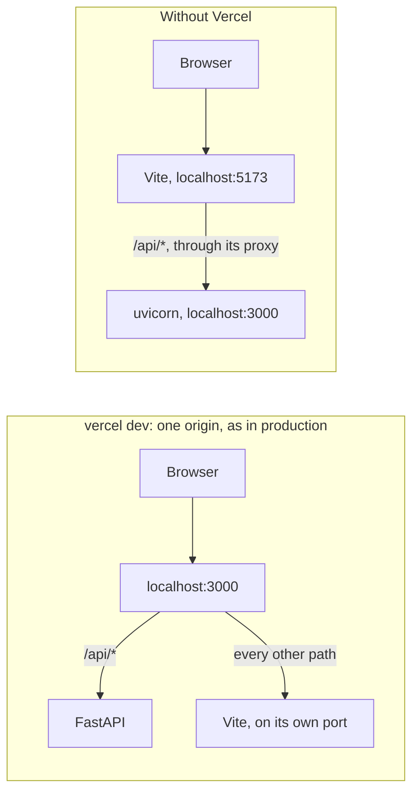
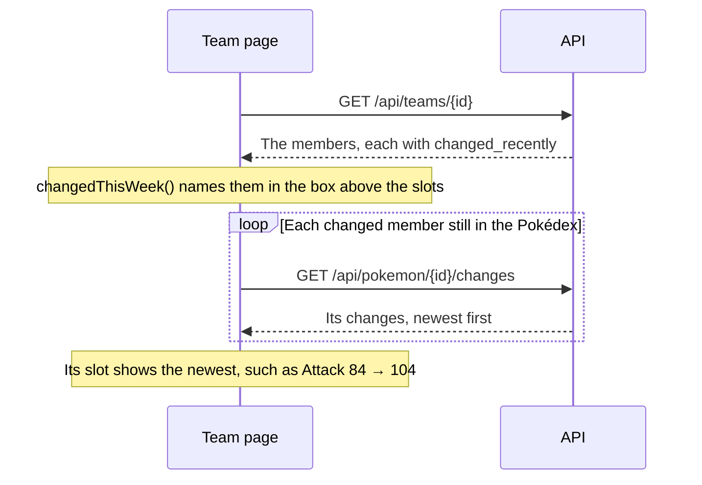
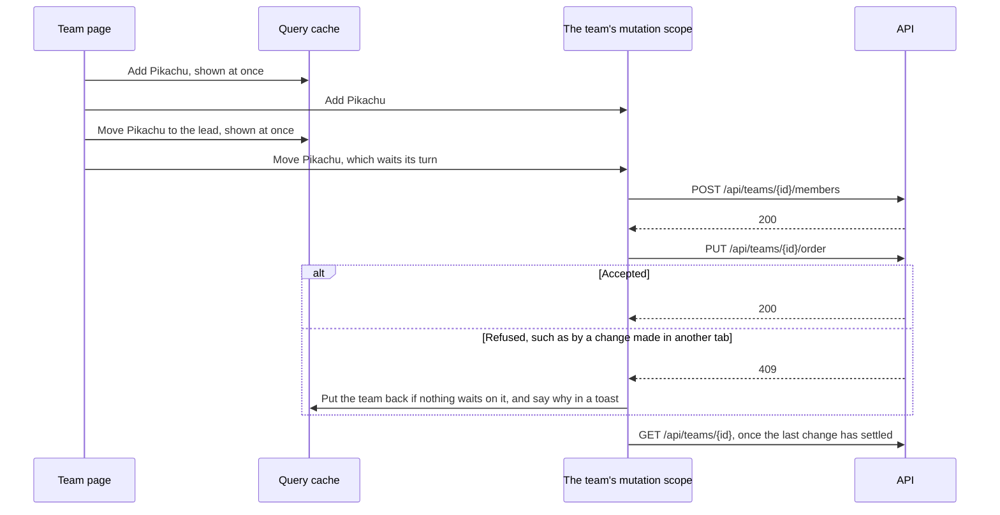

# Counterdex web

Counterdex web is the frontend of Counterdex, a Pokémon team builder with a Pokédex, teams and
accounts. It uses React 19, Vite, TanStack Query, React Router, shadcn/ui and Paraglide, and talks
to a FastAPI backend. The [root README](../README.md) explains why it's built this way. This one
covers working on it.

**Contents**

- [Running it](#running-it)
- [Layout](#layout)
- [Conventions](#conventions)
- [Data from the API](#data-from-the-api)
- [Changes and races](#changes-and-races)
- [Sync status](#sync-status)
- [Team pages](#team-pages)
- [Admin page](#admin-page)
- [Phones](#phones)
- [Tests](#tests)

## Running it

You need a supported Node version and the API on port 3000.

- **Node** `^22.22.2 || ^24.15.0 || >=26`, the versions both the installed jsdom and Vitest
  support (not 25).
- **The API**, started as [backend/README.md](../backend/README.md#running-it) describes. Vite
  sends `/api` requests there.

```bash
npm ci
npm run dev        # http://localhost:5173
```

The API can be on port 3000 in either of two ways:



- **With `vercel dev`:** run it from the repo root after `vercel link`, and open
  http://localhost:3000. It starts Vite itself.
- **Without Vercel:** start the API as described above, and open http://localhost:5173.

Either way, Vite's proxy (`vite.config.ts`) sends `/api` to port 3000, so Vite's own port works in
both.

| Script | What it does |
| --- | --- |
| `npm run dev` | Starts Vite, recompiling messages as they change. |
| `npm run build` | Compiles messages, type-checks, and builds to `dist/`. |
| `npm test` | Runs the tests once (`npm run test:watch` keeps watching). |
| `npm run lint` | Runs oxlint. |
| `npm run api:generate` | Exports the backend's OpenAPI schema to `openapi.json` and regenerates `src/api`. Needs uv. |
| `npm run messages` | Compiles `messages/en.json` into `src/paraglide`. |

## Layout

Code is grouped by feature under `src/`, and imports flow one way: shared code, then features,
then `app/`. The text the app shows is in `messages/en.json`.

| Path | What's in it |
| --- | --- |
| `app/` | The route table, the layout around every page, and the pages in `routes/`, which compose features. |
| `features/` | `admin`, `auth`, `pokedex`, `pokemon-details`, `sync-status` and `teams`, each with the `components/`, `hooks/` and `utils/` it needs. |
| `components/` | Shared UI: `ui/` (shadcn), `layout/` (the app shell), `pokemon/` (cards, badges), `filters/` (the search, type and view filters the Pokédex and the Teams page share), `lists/` (Load more, the grids' card entrance, and their results region and status) and `sync/` (the sync status light). |
| `hooks/` | Shared hooks, such as a debounced search. |
| `lib/` | App-wide helpers: who's signed in, the query client, the theme, dates. |
| `config/` | Page paths. |
| `api/` | The generated API client. |
| `paraglide/` | The generated messages (not committed). |
| `test/` | The MSW (Mock Service Worker) server and handlers that fake the API, render helpers and test data. |
| `main.tsx` | Creates the router from `app/`'s route table and renders the app. |

Features never import each other. `app/` composes them, so a page that needs two features renders
both, such as a team's page with its Pokémon's details.

## Conventions

These rules apply to every change.

- **Don't edit generated code:** `src/api` (from `npm run api:generate`), `src/paraglide` (from
  `npm run messages`) and `src/components/ui` (from `npx shadcn add <component>`).
- **Use the API's own types.** The generated client has every request and response type, a
  function for every route, and TanStack Query options for each. It also has the API's enums as
  runtime values, such as every `PokemonType` and `TeamConflictReason`. An API change then shows up
  as a type error.
- **Put text in `messages/en.json`.** Paraglide compiles it into typed functions. Values from the
  API, such as types and change kinds, are worded by select messages, which pick words by value.
  Tests check that every value has wording.
- **Keep filters and the open Pokémon in the URL**, so a view can be shared or reloaded. The URL
  holds the Pokédex's and the Teams page's filters (`?q=char&type=fire`, `?scope=mine`), and the
  open Pokémon (`?pokemon=6`). Opening a Pokémon adds a history entry, so Back closes it.
- **Change a team through its hooks:** `useAddTeamMember`, `useRemoveTeamMember`,
  `useReplaceTeamMember`, `useReorderTeam` and `useRenameTeam`. Each is built on `useTeamChange`,
  which keeps changes in order. See [Changes and races](#changes-and-races).
- **Build links from `config/paths.ts`**, where every page's path is defined.
- **Use the color tokens** in `src/index.css`, which have light and dark values. Keep saturated
  color for Pokémon types and the status lights.
- **Put text on a type's color in the type's own text color** from `TYPE_STYLES`, at full strength.
  A test checks that every pair reaches 4.5:1 (WCAG AA).
- **Export only components from component files.** Hooks and helpers go in `hooks/`, `utils/` or
  `lib/`. oxlint warns about the rest.
- **Match the style by hand.** There's no formatter. Use single quotes, no semicolons, and lines up
  to about 100 characters.
- **Take only dependency releases at least two weeks old**, with `npm install --before=<date>`.

## Data from the API

Server data lives in TanStack Query, and there's no other store.

- **Each cache key comes from its route and parameters.** Queries use the generated query
  options, such as `listPokemonChangesOptions`, or build on the generated query keys, as
  `teamQueryOptions` does.
- **Data stays fresh for five minutes by default** (`lib/query-client.ts`), the time the API lets
  browsers reuse Pokémon data. Data that must be current stays fresh for less, such as the admin
  page's sync runs.
- **Who's signed in** (`lib/auth.ts`) is checked again whenever the window regains focus.

### How a team shows what changed

The API flags each team member whose Pokémon a sync changed in the last week. The team page then
fetches the details.



- **The box** is `ChangedThisWeekAlert` (`features/teams/components/changed-this-week.tsx`). Its
  sentence comes from `changedThisWeek()` (`features/teams/utils/changed-this-week.ts`). A team's
  card on the Teams page says the same in a muted line, `ChangedThisWeekNote`.
- **A slot's change** comes from `useNewestChange` (`features/teams/hooks/use-newest-change.ts`).
  It fetches only for changed members that aren't removed, since a removed member's slot already
  shows its removal. It shares a cache entry with the Pokémon's details, which show the whole
  history.
- **The box keeps nothing in the browser.** When the week is up, the API stops flagging the member
  and the box goes. Unlike the strip under the header (see [Sync status](#sync-status)), the box
  can't be dismissed.

To see it locally, run the backend's [demo job](../backend/README.md#demoing-a-change).

## Changes and races

A team saves each change as it's made, so several changes can be on their way at once.
`useTeamChange` (`features/teams/hooks/use-team-change.ts`) keeps them straight:

- **One at a time, in order.** Changes to one team share a TanStack Query *mutation scope*
  (`teamChangeScope`). Mutations in one scope run one after another, so each change is sent only
  once the one before has answered. A response can't overtake an earlier one. The API, which locks
  the team for each change, sees them in the order they were made.
- **Shown at once.** Each change is an *optimistic update*, meaning the cache shows it before the
  API answers. It's applied to the cached team and to the team in its owner's cached list of teams.
- **Undone only when nothing depends on it.** If the API refuses a change, a toast says why. The
  team is put back only if no later change is waiting. Otherwise the fetch after the last change
  shows the team as it really is.
- **Fetched again once, at the end.** The team and the team lists are fetched again only after the
  last waiting change has settled. A fetch therefore can't overwrite changes still on their way.
- **One click, one team.** New team ignores clicks while it's creating. The team's id is a UUID
  picked in the browser, so even a repeated request makes one team.



The API's side is in [Atomicity and races](../backend/README.md#atomicity-and-races).

## Sync status

The header's sync status says how long ago the Pokédex was synced. Opening it shows what the latest
sync counted.

If the latest sync succeeded in the last week and added, updated, removed or restored any Pokémon,
three things appear:

- **A history icon** on the status.
- **A link in its popover** to the changed Pokémon.
- **A strip under the header** that says what changed, with the same link.

The link goes to the Pokédex's Changed view (`/pokedex?status=changed`). Dismissing the strip hides
it in this browser until a later sync changes more. The code is in `features/sync-status`.

## Team pages

One subsection per page or view. Paths are relative to `src/features/teams/`, except page files
in `src/app/routes/`.

### Teams page

The Teams page (`/`) lists teams as cards, newest first or, with `?sort=power`, most powerful
first.

- **Whose teams.** Everyone's teams that have a Pokémon, each card saying whose it is. Someone
  signed in can switch to their own, empty ones included (`?scope=mine`).
- **Finding one.** Search, filter by type, or show only "Changed this week".
- **Each card** shows the team as party tiles, its types and its power. It names the members a sync
  changed this week, and any removed from PokéAPI, with the date.

**Files:** `src/app/routes/teams.tsx`, `components/team-card.tsx`.

### A team's page

A team's page (`/teams/:teamId`) is a party screen.

- **The party.** The lead is large, then the other five follow in battle order. Each slot is in its
  main type's color, shows its stats, and opens its details.
- **Power** is the sum of the members' base stat totals.
- **What changed.** A box above the slots names the members a sync changed this week. The lead
  shows its newest change as the Pokédex's change history does. The other slots sum theirs up on
  one line.
- **A removed member** is muted, with the date it was removed in place of its types. The removal is
  its newest change.
- **Below the party**, someone else's team shows [How to beat this team](#how-to-beat-this-team).
  Your own shows [Top threats to your team](#top-threats-to-your-team).
- **The owner** also gets a View / Edit toggle, and a Replace link on each removed member.

**Files:** `src/app/routes/team.tsx`, `components/saved-team.tsx`, `components/team-party.tsx`,
`components/team-slots.tsx`.

### How to beat this team

Under someone else's team, "How to beat this team" shows a counter from `GET /api/counter-team`.

- **Our picks**, in battle order, each with a line on why it's there.
- **A coverage line** says whether every one of theirs has a good answer.
- **A table** rates each pick against each of theirs. Choosing a matchup explains it in one
  sentence (`utils/matchup-sentence.ts`). Where the table doesn't fit, a list gives our best pick
  against each of theirs.
- **Build this counter** saves the counter shown as a new team. It opens that team in Edit, matched
  up against this one, as the Counter button beside the team's name does.

**Files:** `components/how-to-beat-team.tsx`, `components/counter-team-button.tsx`.

### Top threats to your team

Under your own team, "Top threats to your team" shows the Pokémon from `GET /api/team-threats`
that match up best against it. Each threat opens its details.

- **No relatives.** None come from the team's own evolution families.
- **Weak spots.** A line names the members at least half of the threats beat, three at most, then
  how many more. It also names the type more than half of them beat members with, if there is one
  (`utils/weak-spots.ts`).
- **A grid** rates each threat against each member from the member's side, as the counter's table
  rates its picks. The API scores each threat from its own side, so the grid turns each matchup
  around (`utils/turned-around.ts`). A column of bad matchups is then a weak spot, and the caption
  says each cell rates your Pokémon.
- **A list** replaces the grid where it doesn't fit. It shows each threat with thumbs of the
  members it beats.

**Files:** `components/team-threats.tsx`, `components/threats-grid.tsx`.

### What both matchup sections share

Both sections have the same two controls.

- **Wider pools.** Either can also pick from alternate forms and legendaries. The choice is kept in
  the URL (`?alternate_forms=true&legendaries=true`, apart from the Pokédex filters' `?forms=`). So
  signing in to build a counter comes back to the same one.
- **How it works**, folded away under each section's description, says how the section chooses its
  Pokémon and how a matchup is scored (`components/matchup-how-it-works.tsx`). Its words repeat the
  API's weights in `backend/app/counter/constants.py`, so changing a weight means changing the
  words too.

### Edit

Edit (`/teams/:teamId/edit`) puts the owner's team beside the Pokédex. From `lg` up, the team is a
column pinned at the left. The Pokédex fills the rest, with the Pokédex page's filters (kept in the
URL) and cards.

- **The column** has the team's name to rename, the same box above the slots, and the slots. Each
  changed member's slot shows its change on one line. Each member has a remove button, and each
  removed one a Replace link.
- **Adding.** Each card's button adds its Pokémon, or puts it in the place of the member from its
  evolution family. If the Pokémon can't join, because it's on the team or the team is full, the
  button says so.
- **Replacing.** A Replace link sets `?replace=<id>`. A box above the Pokédex asks for the
  Pokémon, and each card's button then replaces that member.
- **Reordering.** Dragging a member's slot onto another's puts the team in a new order, and the
  first is the lead. Drag with a mouse, or with a finger: at once on the handle, or elsewhere on the
  slot after holding still a moment, so a swipe still scrolls. With the keyboard, press Space on
  the handle, then the arrow keys, then Space.
- **Matching up.** With `?against=<team id>`, a panel below the slots matches the team up against
  that one as it changes. Building a counter opens Edit this way. The panel shows whether each of
  theirs has a good answer, why each of ours is there, and our best answer to each of theirs.
  Pressing an answer explains it in a sentence.
- **Details and leaving.** Tapping a card or a slot opens its details. Every change saves at once,
  so the toggle back to View is the way out.

**Files:** `src/app/routes/team-edit.tsx`, `components/team-card-action.tsx`,
`components/sortable-members.tsx`, `components/against-team.tsx`.

### Add to team

The Pokédex page (`/pokedex`) has Add to team on each card and in a Pokémon's details.

- **The menu** lists your teams with how many Pokémon each has. One that can't take the Pokémon
  says why.
- **New team** makes a team with the Pokémon and opens it in Edit.
- **Signed out**, the menu links to signing in and back.
- **A Pokémon PokéAPI no longer lists** has no Add to team.

**Files:** `components/add-to-team-menu.tsx`.

## Admin page

**Admin** (`/admin`) is for admins only, and is linked from an admin's account menu.

- **Anyone else** is told so, and the page never asks for its data. The API's 403 is what keeps
  that data from them.
- **The Sync runs widget** lists every sync, a page at a time, with the page in the URL
  (`?page=2`). It's a table from `lg` up, and a list of cards below that.

## Phones

Every page has to work at phone width.

- **Below `md`**, navigation is a tab bar at the bottom. It hides while scrolling down and comes
  back on any scroll up. A Pokémon's details open as a bottom sheet.
- **Toasts** take their distance from the bottom from `--toaster-bottom`. Below `md`, they sit
  above the tab bar. From `md` up, they use sonner's default 24px. On a page with a floating button
  (marked `data-floating-button`), they sit above that too.
- **Below `lg`**, the header's sync status is just its light and a short age, or "Failed". Screen
  readers still get the full words.
- **Below `lg`, Edit** shows the team first. Its floating Add Pokémon button opens the Pokédex in a
  sheet as tall as the screen. The sheet also opens by itself when a member is to be replaced. The
  box asking for that Pokémon is above the slots and in the sheet. The `?against` panel's picks
  and answers start folded away.
- **Slots narrower than 34rem** in Edit, as in its column and on phones, leave out their Pokédex
  numbers and base stat totals. View's party keeps them.
- **A Replace link is just its icon** below `sm`, and in those narrow Edit slots.

## Tests

Tests run in Vitest with jsdom and Testing Library.

- **Each test gets its own providers.** `renderWithProviders` in `src/test/render.tsx` gives it its
  own query client and router.
- **MSW answers the app's real requests.** The helpers in `src/test/handlers.ts` serve each
  endpoint and record what was asked for. A request with no handler is an error.
