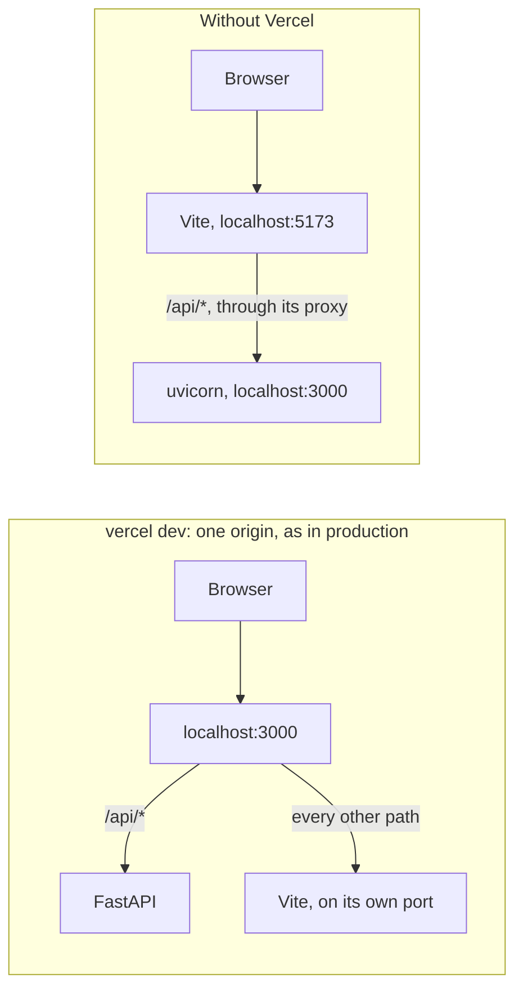
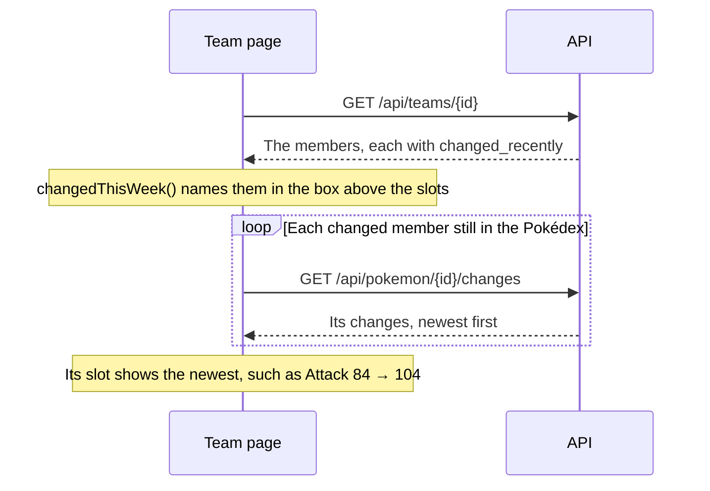
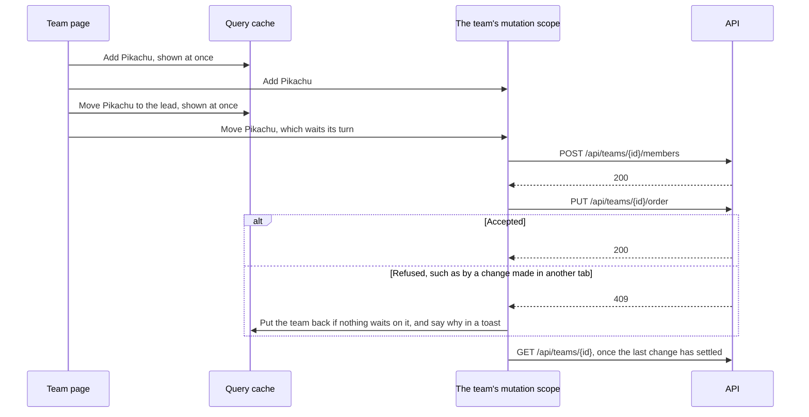

# Counterdex web

This is the frontend of Counterdex, a Pokémon team builder with a Pokédex, teams and accounts. It's
a React 19 app built with Vite, TanStack Query, React Router, shadcn/ui and Paraglide, and it talks
to a FastAPI backend. The [root README](../README.md) explains why the app is built this way. This
guide is about working on it, and it has these sections.

- [Running it](#running-it)
- [Layout](#layout)
- [Conventions](#conventions)
- [Data from the API](#data-from-the-api)
- [Changes and races](#changes-and-races)
- [Sync status](#sync-status)
- [Team pages](#team-pages)
- [Admin page](#admin-page)
- [Phones](#phones)
- [Tests](#tests)

## Running it

You'll need a supported version of Node, and the API running on port 3000.

Node has to be version 22.22.2 or later in 22, 24.15.0 or later in 24, or 26 and up
(`^22.22.2 || ^24.15.0 || >=26`). Those are the versions that both the installed jsdom and Vitest
support, so Node 25 won't work.

Start the API as the [backend guide](../backend/README.md#running-it) describes. Vite sends every
`/api` request to it. Then install the packages and start Vite.

```bash
npm ci
npm run dev        # http://localhost:5173
```

There are two ways to have the API on port 3000.



With Vercel, you run `vercel dev` from the repository's root folder and open
http://localhost:3000. You need to run `vercel link` once before the first time. It serves the app
and the API on one origin, just as production does, and it starts Vite for you.

Without Vercel, you start the API with uvicorn as the backend guide describes, and open
http://localhost:5173.

Either way, Vite's proxy in `vite.config.ts` sends `/api` to port 3000. That's why the app works
on Vite's own port in both setups.

These are the scripts you'll use.

| Script | What it does |
| --- | --- |
| `npm run dev` | Starts Vite, and recompiles the messages whenever they change. |
| `npm run build` | Compiles the messages, type-checks the code, and builds the app into `dist/`. |
| `npm test` | Runs the tests once. `npm run test:watch` keeps running them as you edit. |
| `npm run lint` | Runs oxlint. |
| `npm run api:generate` | Exports the backend's OpenAPI schema to `openapi.json` and regenerates `src/api` from it. It needs uv. |
| `npm run messages` | Compiles `messages/en.json` into `src/paraglide`. |

## Layout

The code under `src/` is grouped by feature. Imports only go one way. Features use the shared code,
and `app/` uses the features, but never the other way round. All the text the app shows is in
`messages/en.json`.

| Path | What's in it |
| --- | --- |
| `app/` | The route table, the layout around every page, and the pages themselves in `routes/`. Each page is put together from features. |
| `features/` | A folder each for `admin`, `auth`, `pokedex`, `pokemon-details`, `sync-status` and `teams`. Each one has the `components/`, `hooks/` and `utils/` it needs. |
| `components/` | Shared UI. This includes `ui/` (the shadcn components), `layout/` (the app shell), `pokemon/` (cards and badges) and `filters/` (the search, type and view filters that the Pokédex and the Teams page share). It also has `lists/` (the Load more button, the animation that deals the grids' cards in, and the grids' results region and status) and `sync/` (the sync status light). The load-failed alert and the disclosure that features share live here too. |
| `hooks/` | Shared hooks, such as a debounced search. |
| `lib/` | App-wide helpers for who's signed in, the query client and `dataOrNull` for its queries, the theme, dates and lists. |
| `config/` | Page paths. |
| `api/` | The generated API client. |
| `paraglide/` | The generated messages. They aren't committed. |
| `test/` | The MSW (Mock Service Worker) server and handlers that fake the API, plus render helpers and test data. |
| `main.tsx` | Creates the router from `app/`'s route table and renders the app. |

Features never import each other. Instead, `app/` puts them together, so a page that needs two
features renders both. For example, a team's page also shows its Pokémon's details.

## Conventions

These rules apply to every change.

Don't edit generated code. That covers `src/api`, which comes from `npm run api:generate`, and
`src/paraglide`, which comes from `npm run messages`. It also covers `src/components/ui`, which
comes from `npx shadcn add <component>`.

Use the API's own types. The generated client has every request and response type, a function for
every route, and TanStack Query options for each route. It also has the API's enums as runtime
values, such as every `PokemonType` and `TeamConflictReason`. That way, a change to the API shows up
as a type error.

Put all text in `messages/en.json`. Paraglide compiles it into typed functions. Values that come
from the API, such as Pokémon types and kinds of change, are worded by select messages, which pick
their words based on the value. Tests check that every value has wording.

Keep filters and the open Pokémon in the URL, so that a view can be shared or reloaded. The URL
holds the filters for the Pokédex and the Teams page (`?q=char&type=fire`, `?scope=mine`) and the
open Pokémon (`?pokemon=6`). Opening a Pokémon adds a history entry, so the Back button closes it.

Change a team only through its hooks, which are `useAddTeamMember`, `useRemoveTeamMember`,
`useReplaceTeamMember`, `useReorderTeam` and `useRenameTeam`. Each one is built on `useTeamChange`,
which keeps changes in order. [Changes and races](#changes-and-races) explains how.

Build links from `config/paths.ts`, where every page's path is defined.

Use the color tokens in `src/index.css`, which have light and dark values. Save strong, saturated
color for Pokémon types and the status lights.

When text sits on a type's color, give it that type's own text color from `TYPE_STYLES`, at full
strength. A test checks that every pair has a contrast ratio of at least 4.5 to 1, which is the
WCAG AA level.

Export only components from component files. Hooks and helpers go in `hooks/`, `utils/` or `lib/`,
and oxlint warns about anything else.

Match the code style by hand, because there's no formatter. Use single quotes, no semicolons, and
lines of up to about 100 characters.

Only take dependency releases that are at least two weeks old, by installing with
`npm install --before=<date>`.

## Data from the API

All data from the server lives in TanStack Query's cache, and there's no other store.

Each cache key comes from its route and its parameters. Queries either use the generated query
options, such as `listPokemonChangesOptions`, or build on the generated query keys, as
`teamQueryOptions` does.

By default, TanStack Query treats data as fresh for five minutes, so it won't fetch it again in that
time. This is set in `lib/query-client.ts`, and it matches how long the API lets browsers reuse
Pokémon data. Data that has to be current, such as the admin page's sync runs, stays fresh for less
time.

The app checks who's signed in again whenever the window regains focus. That code is in
`lib/auth.ts`.

### How a team shows what changed

The API flags each team member whose Pokémon a sync changed in the last week. The team page then
fetches the details.



The box above the slots is `ChangedThisWeekAlert`, in
`features/teams/components/changed-this-week.tsx`. Its sentence comes from `changedThisWeek()` in
`features/teams/utils/changed-this-week.ts`. On the Teams page, a team's card says the same thing
in a muted line, using `ChangedThisWeekNote`.

Each slot's change comes from `useNewestChange`, in `features/teams/hooks/use-newest-change.ts`.
It only fetches for changed members that haven't been removed, because a removed member's slot
already shows its removal. It shares a cache entry with the Pokémon's details, which show the whole
history.

The box doesn't keep anything in the browser. Once the week is up, the API stops flagging the
member and the box goes away. Unlike the strip under the header (see [Sync status](#sync-status)),
the box can't be dismissed.

To see this on your own machine, run the backend's
[demo job](../backend/README.md#demoing-a-change).

## Changes and races

A team saves each change as soon as it's made, so several changes can be on their way to the API
at once. `useTeamChange`, in `features/teams/hooks/use-team-change.ts`, keeps them straight in the
following ways.

Changes are sent one at a time, in order. All the changes to one team share a TanStack Query
mutation scope (`teamChangeScope`). A mutation is TanStack Query's name for a request that changes
data, and mutations in the same scope run one after another. So each change is sent only once the
one before it has had an answer, and a response can never overtake an earlier one. The API, which
locks the team for each change, sees them in the order they were made.

Changes show up straight away. Each change is an optimistic update, which means the cache shows it
before the API answers. It's applied both to the cached team and to the team in its owner's cached
list of teams.

A refused change is undone only when nothing depends on it. If the API refuses a change, a toast
says why. The team is put back only if no later change is waiting. Otherwise, the fetch after the
last change shows the team as it really is.

The team is fetched again just once, at the end. The team and the team lists are fetched again only
after the last waiting change has settled, so a fetch can't overwrite changes that are still on
their way.

One click makes one team. The New team button ignores clicks while it's creating a team. The new
team's id is a UUID picked in the browser, so even a repeated request makes only one team.



The backend guide covers the API's side of this in
[Atomicity and races](../backend/README.md#atomicity-and-races).

## Sync status

The sync status in the header says how long ago the Pokédex was synced. Opening it shows what the
latest sync counted.

If the latest sync succeeded in the last week and added, updated, removed or restored any Pokémon,
three things appear. The status gets a history icon, its popover gets a link to the changed
Pokémon, and a strip under the header says what changed, with the same link.

The link goes to the Pokédex's Changed view (`/pokedex?status=changed`). Dismissing the strip hides
it in this browser until a later sync changes more. The code is in `features/sync-status`.

## Team pages

There's one subsection below for each page or view. The file paths in this section are relative to
`src/features/teams/`, except for the page files, which are in `src/app/routes/`.

### Teams page

The Teams page (`/`) lists teams as cards. They're shown newest first, or most powerful first with
`?sort=power`.

It shows everyone's teams that have at least one Pokémon, and each card says whose team it is. If
you're signed in, you can switch to just your own teams, including empty ones (`?scope=mine`). You
can also search, filter by type, or show only the teams that changed this week.

Each card shows the team as party tiles, along with its types and its power. It names the members
that a sync changed this week, and any that were removed from PokéAPI, with the date.

The code for this is in `src/app/routes/teams.tsx` and `components/team-card.tsx`.

### A team's page

A team's page (`/teams/:teamId`) is laid out as a party screen. The lead is shown large, and the
other five follow in battle order. Each slot is in its main type's color, shows the Pokémon's
stats, and opens its details. The team's power is the sum of its members' base stat totals.

A box above the slots names the members that a sync changed this week. The lead shows its newest
change the same way the Pokédex's change history does, and each of the other slots sums its change
up in one line. A member that was removed from PokéAPI is muted, and shows the date it was removed
in place of its types. That removal is its newest change.

Below the party, someone else's team shows [How to beat this team](#how-to-beat-this-team), and
your own team shows [Top threats to your team](#top-threats-to-your-team). The owner also gets a
View / Edit toggle, and a Replace link on each removed member.

The code for this is in `src/app/routes/team.tsx`, `components/saved-team.tsx`,
`components/team-party.tsx` and `components/team-slots.tsx`. Each slot's parts are in
`member-panel.tsx`, `empty-slots.tsx` and `slot-controls.tsx`.

### How to beat this team

Under someone else's team, the "How to beat this team" section shows a counter team from
`GET /api/counter-team`.

It lists the counter's picks in battle order, each with a line saying why it's there. A coverage
line says whether every Pokémon on their team has a good answer.

A table rates each pick against each of their Pokémon. Choosing a matchup explains it in one
sentence, which comes from `utils/matchup-sentence.ts`. Where the table doesn't fit, a list shows
the best pick against each of their Pokémon instead.

The Build this counter button saves the counter that's shown as a new team. It then opens that team
in Edit, matched up against the team you were looking at, which is what the Counter button beside
the team's name does too.

The code for this is in `components/how-to-beat-team.tsx` and `components/counter-team-button.tsx`.

### Top threats to your team

Under your own team, the "Top threats to your team" section shows the Pokémon from
`GET /api/team-threats` that match up best against it. Each threat opens its details. None of the
threats come from your team's own evolution families.

A line sums up the team's weak spots. It names the members that at least half of the threats beat,
up to three of them, and then says how many more there are. If more than half of the threats beat
your members with the same type, it names that type too. This logic is in `utils/weak-spots.ts`.

A grid rates each threat against each member from your member's side, the same way the counter's
table rates its picks. The API scores each threat from its own side, so the grid turns each
matchup around (`utils/turned-around.ts`). That way, a column of bad matchups shows a weak spot,
and the grid's caption says that each cell rates your Pokémon.

Where the grid doesn't fit, a list replaces it. The list shows each threat with small pictures of
the members it beats.

The code for this is in `components/team-threats.tsx` and `components/threats-grid.tsx`.

### What both matchup sections share

Both matchup sections have the same two controls.

The first lets either section pick from a wider pool that includes alternate forms and legendaries.
The choice is kept in the URL as `?alternate_forms=true&legendaries=true`, which is separate from
the Pokédex filters' `?forms=`. Because it's in the URL, signing in to build a counter brings you
back to the same counter.

The second is a "How it works" panel, folded away under each section's description. It explains
how the section chooses its Pokémon and how a matchup is scored
(`components/matchup-how-it-works.tsx`). Its wording repeats the API's weights from
`backend/app/counter/constants.py`, so if you change a weight, you need to change the wording too.

### Edit

Edit (`/teams/:teamId/edit`) puts the owner's team next to the Pokédex. From the `lg` breakpoint
up, the team is a column pinned at the left, and the Pokédex fills the rest of the page. The
Pokédex here has the same filters as the Pokédex page, kept in the URL, and the same cards.

The column starts with the team's name, which you can edit to rename the team. Below that are the
same box as on the team's page and then the slots. Each changed member's slot shows its change in
one line. Every member has a remove button, and every removed member has a Replace link.

To add a Pokémon, you use the button on its card. If the team already has a member from the same
evolution family, the button puts the new Pokémon in that member's place instead. If the Pokémon
can't join, because it's already on the team or the team is full, the button says so.

A Replace link sets `?replace=<id>`. A box above the Pokédex then asks you to pick a Pokémon, and
each card's button replaces that member.

To reorder the team, you drag one member's slot onto another's, and the first slot is the lead.
You can drag with a mouse or with a finger. With a finger, dragging on the handle starts at once.
Elsewhere on the slot, it starts after you hold still for a moment, so a swipe still scrolls the
page. With the keyboard, you press Space on the handle, move the slot with the arrow keys, and
press Space again.

With `?against=<team id>` in the URL, a panel below the slots matches the team up against that
other team, and updates as you change yours. Building a counter opens Edit this way. The panel
shows whether each of their Pokémon has a good answer, why each of yours is there, and your best
answer to each of theirs. Pressing an answer explains it in a sentence.

Tapping a card or a slot opens its details. Every change saves straight away, so the way out of
Edit is the toggle back to View.

The code for this is in `src/app/routes/team-edit.tsx`, `components/team-card-action.tsx`,
`components/sortable-members.tsx` and `components/against-team.tsx`.

### Add to team

The Pokédex page (`/pokedex`) has an Add to team button on each card and in each Pokémon's
details.

Its menu lists your teams with how many Pokémon each one has. If a team can't take the Pokémon, the
menu says why. The New team option makes a team with the Pokémon in it and opens it in Edit. If
you're signed out, the menu links you to sign in and then brings you back. A Pokémon that PokéAPI
no longer lists has no Add to team button.

The code for this is in `components/add-to-team-menu.tsx`.

## Admin page

The Admin page (`/admin`) is only for admins, and it's linked from an admin's account menu. Anyone
else is told so, and the page never asks the API for its data. What actually keeps that data from
them is the API, which answers with a 403.

The Sync runs widget lists every sync, a page at a time, with the page number in the URL
(`?page=2`). It's a table from `lg` up, and a list of cards below that.

## Phones

Every page has to work at phone width. The sizes below use Tailwind's standard breakpoints, `sm`,
`md` and `lg`.

Below `md`, navigation moves to a tab bar at the bottom of the screen. The tab bar hides while you
scroll down and comes back on any scroll up. A Pokémon's details open as a bottom sheet.

Toasts, the short pop-up messages, take their distance from the bottom of the screen from
`--toaster-bottom`. Below `md` they sit above the tab bar, and from `md` up they use sonner's
default of 24px. On a page with a floating button (marked with `data-floating-button`), they sit
above that button too.

Below `lg`, the header's sync status shrinks to just its light and a short age, or "Failed". Screen
readers still get the full words.

Below `lg`, Edit shows the team first. Its floating Add Pokémon button opens the Pokédex in a sheet
as tall as the screen. The sheet also opens by itself when a member is being replaced, and the box
asking for the new Pokémon appears both above the slots and in the sheet. The `?against` panel's
picks and answers start folded away.

In Edit, slots narrower than 34rem leave out their Pokédex numbers and base stat totals. That
happens in Edit's column and on phones. The party in View keeps them.

Below `sm`, a Replace link shows only its icon. The same goes for Replace links in those narrow
Edit slots.

## Tests

The tests run in Vitest, using jsdom (which imitates a browser inside Node) and Testing Library.

Each test gets its own providers. `renderWithProviders` in `src/test/render.tsx` gives every test
its own query client and router.

MSW fakes the API by answering the app's real requests. The helpers in `src/test/handlers/`, one
file per resource, serve each endpoint and record what was asked for. A request with no handler is
an error. `src/test/server.ts` has the shared helpers, such as one that holds a request until a test
lets it go, and one that makes a request fail once.
